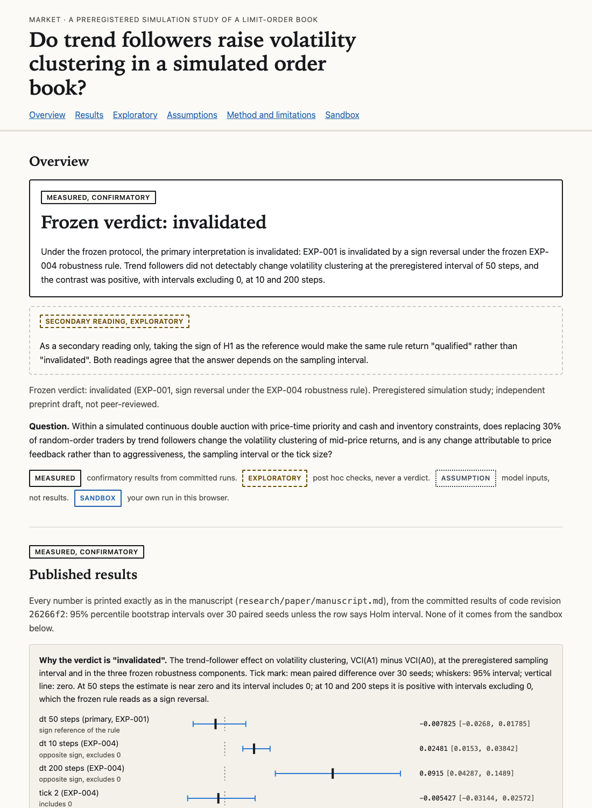

<!-- SPDX-License-Identifier: LicenseRef-MARKET-NC-Research-1.0 -->
# MARKET: do trend followers raise volatility clustering in a simulated limit-order book?

**Status: frozen verdict "invalidated".** Under the frozen protocol v1.0 (owner-approved 2026-11-24, `research/freeze.json`), the primary interpretation of EXP-001 is invalidated by a sign reversal under the frozen EXP-004 robustness rule. All 480 confirmatory runs completed with no failure. Independent research manuscript / preprint draft, not peer-reviewed, not submitted anywhere. Full-text owner review of the manuscript is pending (M6). Simulated markets only: nothing here is a statement about real markets, a prediction, trading advice or a claim of profitability.



## Question

Within a simulated continuous double auction with price-time priority and cash and inventory constraints, does replacing 30% of random-order traders by trend followers change the volatility clustering of mid-price returns, and is any change attributable to price feedback rather than to aggressiveness, the sampling interval or the tick size? Volatility clustering is measured by VCI, the mean autocorrelation of absolute mid-price returns at lags 1 to 10.

## Why it matters

Random order flow alone already reproduces much of the behaviour of real order books in published models, and chartist traders have been credited with volatility clustering. A trend follower differs from a random-order trader both in its price feedback and in how aggressively it trades, so a difference between the two markets does not by itself identify the feedback. This study tests the question with paired seeds, an aggressiveness-matched placebo arm and preregistered sensitivity rules.

## Key findings (verified; numbers as printed in the manuscript)

- **Primary (EXP-001), frozen verdict: invalidated.** At the preregistered sampling interval of 50 steps, VCI(A1) minus VCI(A0) is -0.007825, 95% bootstrap interval [-0.0268, 0.01785], 30 paired seeds: inconclusive on its own, not evidence of no effect. The frozen robustness rule (EXP-004) found a sign reversal: the same contrast is 0.02481 [0.0153, 0.03842] at 10 steps and 0.0915 [0.04287, 0.1489] at 200 steps.
- **Secondary reading (exploratory).** Taking the sign of H1 as the rule's reference would return "qualified" rather than "invalidated". Both readings agree that the answer depends on the sampling interval.
- **Placebo (EXP-004).** Price-independent aggressive agents raised VCI (A4 minus A0 0.01751, [0.0135, 0.02148]); trend followers added nothing beyond them (A1 minus A4 -0.02534, [-0.04414, -0.0002837]).
- **Liquidity (EXP-002), supported.** Lower limit-order supply widened the mean spread by 1.632 price units, [1.624, 1.641]. The low-ZI+TF arm was degenerate in 30 of 30 runs and is excluded from contrasts.
- **Shock (EXP-003), supported.** Trend followers deepened the post-shock drawdown by 0.02545 of the pre-shock mid, [0.01976, 0.03148]. Spread widening was **not measured** (the protocol gives no formula).
- **Real data (EXP-005), descriptive.** On the FI-2010 held-out day, VCI was positive in 4 of 5 stocks, so hypothesis (a) is not supported; the placement of the simulated arms is descriptive only.

## Experiments

| ID | Title | Status | Verdict under the frozen rule | Report |
| --- | --- | --- | --- | --- |
| EXP-001 | Agent mixtures and volatility clustering | complete, 120/120 runs | invalidated (sign reversal, EXP-004 rule); primary contrast inconclusive | `research/experiments/EXP-001/report.md` |
| EXP-002 | Liquidity supply and spread | complete, 180/180 runs | supported | `research/experiments/EXP-002/report.md` |
| EXP-003 | Response to an exogenous sell shock (optional) | complete, 90/90 runs | supported; spread widening not measured | `research/experiments/EXP-003/report.md` |
| EXP-004 | Sensitivity analyses that could invalidate EXP-001 | complete, 90/90 runs | robustness rule: invalidated (sign reversal) | `research/experiments/EXP-004/report.md` |
| EXP-005 | Simulated and real-market statistics (FI-2010) | complete, 0 new runs | (a) not supported; (b) descriptive | `research/experiments/EXP-005/report.md` |

## Research navigation

- Manuscript: `research/paper/manuscript.md` (supplement `supplementary.md`, LaTeX `manuscript.tex`; no PDF yet, M6).
- Protocols: `research/protocol.md` and `research/experiments/EXP-00N/protocol.md`; freeze record `research/freeze.json`.
- Claims register `research/claims_register.csv`; artifact manifest and evidence audit `research/publication/`; limitations `research/limitations.md`; decisions `research/decision_log.md`.
- Raw per-run results, analysis outputs and SHA256SUMS: `results/confirmatory/`; exploratory outputs: `results/exploratory/`.
- Articles (drafts, not published): `articles/medium.md`, `articles/linkedin.md`.

## What is implemented

- A simulation engine (`src/market/`): price-time-priority order book with partial fills and expiry, cash and inventory accounting (no negative balances, exact conservation), random-order, trend-following, mean-reverting and placebo agents, seeded named random streams, metrics, versioned result schemas, run manifests, a runner that refuses any confirmatory config whose bytes differ from the freeze record, FI-2010 ingestion and report generators. Tests in `tests/`.
- A static interactive page (`demo/`): the published results with their intervals, exactly as the manuscript prints them, and an order-book sandbox that runs a TypeScript port of the engine in a Web Worker (identical to the Python engine on a test fixture). It runs offline after the first load and collects nothing.

## Quick start

```
/Users/bechir/research/labs/.tools/py/bin/uv sync --frozen --all-groups --all-extras
.venv/bin/python -m pytest
.venv/bin/python -m market.cli smoke
```

Demo (Node 22; no runtime service):

```
cd demo && npm ci && npm run build && npm run preview
```

## Full reproduction

```
.venv/bin/python -m market.cli run --exp EXP-001 --workers 2     # likewise EXP-002 to EXP-004
.venv/bin/python -m market.frozen_analysis --exp EXP-001         # likewise EXP-002 to EXP-004
.venv/bin/python -m market.cli realdata compare --exp EXP-005 --results results/confirmatory/EXP-001
.venv/bin/python scripts/m4_exploratory.py --workers 2           # exploratory M4 checks
.venv/bin/python scripts/m4_tables.py                            # manuscript tables and figures
.venv/bin/python scripts/m4_audit.py                             # artifact manifest and audit
.venv/bin/python scripts/export_demo_data.py                     # demo/public/data/results.json
.venv/bin/python scripts/make_demo_fixture.py                    # engine fixture for the demo's port test
```

Runs are deterministic given seed and code revision. FI-2010 is fetched by `scripts/download_fi2010.py` with SHA-256 checks.

## Architecture

`src/market/` separates the order book (`book.py`), accounting (`ledger.py`), agents (`agents.py`), simulation (`simulate.py`), metrics (`metrics.py`), runner and schemas (`runner.py`, `schema.py`), frozen analysis (`frozen_analysis.py`) and reports (`report.py`). `scripts/` holds the evidence pipeline: one generator for tables and figures, reused by the reports, the manuscript, the demo export and the articles. `demo/` is TypeScript, React and Vite; it reads only `demo/public/data/results.json` and fails closed if that file is malformed.

## Data sources and licences

- Simulated data, generated by the engine from recorded seeds.
- FI-2010 (Ntakaris et al. 2018), NASDAQ Nordic limit-order-book data, CC BY 4.0; used only for the descriptive comparison EXP-005, downloaded by script and never committed (`data/manifest.json`).

## Limitations

VCI is one statistic and, in this model, it is shaped by bid-ask bounce at short sampling intervals and by trend runs at long intervals. The EXP-004 verdict depends on the sign reference of the robustness rule. The primary test had low power for the effect that occurred. One parameter set, 100 fixed-rule agents, one asset; the model is not calibrated to any market. Full list: `research/limitations.md` and manuscript section 7.

## Cost and scope

Zero cost: local laptop only; no paid API, data, compute or hosting. Repository and demo URL: [placeholder, not yet published].

## Licence

MARKET Source-Available Non-Commercial Research License v1.0 (`LicenseRef-MARKET-NC-Research-1.0`). This is a custom, source-available licence, not an OSI-approved open-source licence. See `LICENSE`, `NOTICE.md` and `research/decision_log.md` (D-001). Third-party data and dependencies keep their own licences.

## Citation

See `CITATION.cff`. Author metadata as approved by the owner (authorship decision C3); no institutional affiliation is claimed. Funding and competing interests: none are recorded in the project files; the owner confirms both statements before any release. AI assistance (Claude, Anthropic) is disclosed in manuscript section 11; the AI system is not an author.
