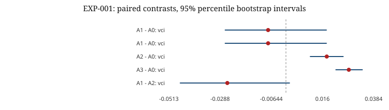
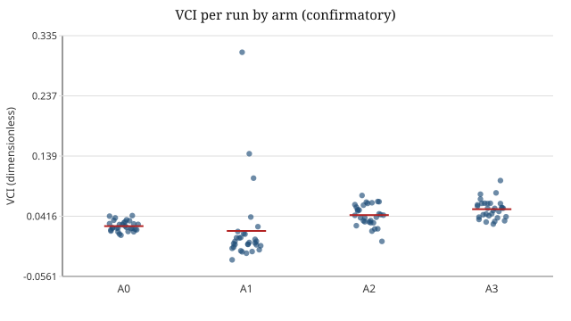
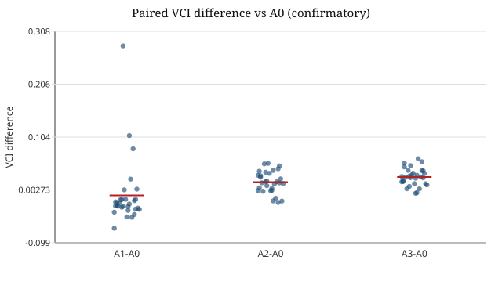
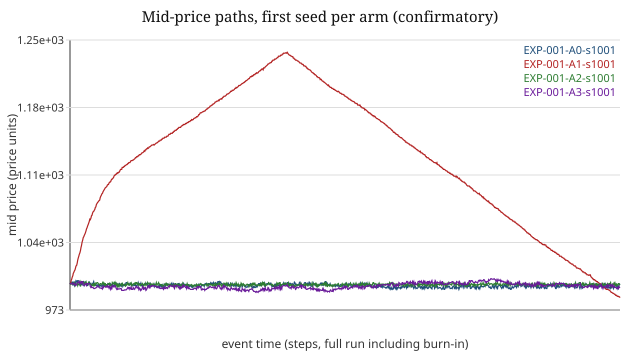

<!-- SPDX-License-Identifier: LicenseRef-MARKET-NC-Research-1.0 -->
# EXP-001: Agent mixtures and volatility clustering (report)

**Experiment:** EXP-001. **Date:** 2026-11-25. **Version:** protocol v1.0 (frozen 2026-11-24). **Status:** complete, confirmatory, 120 of 120 planned runs. **Authorship:** Mohamed Bechir Kefi (approved authorship, C3); AI research and development assistant disclosed, not an author. **Protocol SHA-256:** `3edbb40f44b8e31920e7cf5d35204a932ce0adcdca67b8c73e93ac7e074ea307`. **Code revision:** `26266f2bf6efe2df1e1c1738e9b12e90f169731e`.

## 1. Executive summary

Question: does replacing 30% of random-order (ZI) agents by trend followers (TF) raise the volatility clustering index (VCI) relative to an all-ZI market? Method: four arms (A0 all ZI, A1 70 ZI + 30 TF, A2 70 ZI + 30 MR, A3 70 ZI + 15 TF + 15 MR), 30 paired seeds each, 100,000 steps. Outcome: the mean paired difference VCI(A1) - VCI(A0) is -0.007825 with 95% bootstrap interval [-0.0268, 0.01785] (d_z = -0.121, n = 30 pairs). Under the frozen rule the hypothesis H1 is **inconclusive**: the interval includes 0, so trend followers did not detectably raise clustering at the primary sampling interval, and this is not evidence of no effect. Principal caveat: the same contrast is positive with intervals excluding 0 at `dt` = 10 and 200 (EXP-004), so the answer depends on the sampling interval, and A1's VCI varies much more across seeds than A0's.

## 2. Rationale and literature

Random-order double-auction models reproduce much of the spread and diffusion of real books (Farmer, Patelli and Zovko 2005; Smith et al. 2003), so the all-ZI market is the null model. In an order-driven model with fundamentalist, chartist and noise traders, the chartist component was reported as the main source of clustering (Chiarella, Iori and Perello 2009, arXiv 0711.3581). Volatility clustering is a stylized fact (Cont 2001). The gap addressed is a small, tested, paired-seed measurement of the TF effect against the random-order baseline, with a placebo control (EXP-004).

## 3. Hypotheses and operational definitions

- `r_k = ln m_{B + k dt} - ln m_{B + (k-1) dt}`, `dt = 50` steps, `B = 10,000`; `VCI = (1/10) sum_{l=1..10} acf(|r|, l)` per run (dimensionless).
- `D_s = VCI(A1, s) - VCI(A0, s)`. H0: `E[D] = 0`. H1: `E[D] > 0`. Supported if the 95% interval lies above 0; contradicted if it lies below 0; otherwise inconclusive (never equivalence).
- Control: A0. Secondary contrasts A2 - A0, A3 - A0, A1 - A2 on VCI and nine secondary metrics, Holm-adjusted (D-013 construction).

## 4. Methodology

- Simulation model: `research/protocol.md` sections 3 and 3.6 (frozen v1.0), engine `market.simulate`; metrics `market.metrics` (protocol section 5).
- Frozen config: `experiments/configs/EXP-001.json`, SHA-256 `de89e25b290c985583d242c51bfd2b35efb9dfd65310a8816b847bf17e3bc9d0` (copied as [`config.json`](config.json)).
- Seeds: 1001 to 1030, common random numbers across arms. Hardware and software: Apple M1 Pro, 10 cores, Darwin 24.3.0 (macOS-15.3.1-arm64-arm-64bit), Python 3.12.1, numpy 2.5.4, market 0.0.0.
- Execution: `nice -n 10 .venv/bin/python -m market.cli run --exp EXP-001 --workers 2`, through the freeze guard (`market.runner.check_gate`). Batch EXP-001-20261124T233632Z, start 2026-11-24T23:34:41Z, end 2026-11-24T23:36:32Z (UTC), exit code 0, wall time 111.3 s; 120 runs, 0 failed, none dropped. The machine was shared with other sessions (load average up to about 84 during the batches), so runtimes are not benchmark timings.
- Code revision: `26266f2bf6efe2df1e1c1738e9b12e90f169731e` (working tree clean of tracked changes: True). Data manifest SHA-256 `0d78d1707ae5d93f757105eae90f5b0f554cb4993ef0e9e21cb2f28d0799cdab`.
- Per-run provenance: [`provenance.csv`](../../../results/confirmatory/EXP-001/provenance.csv) (run id, config hash, seed, revision, data manifest hash, hardware, batch start and end, runtime, status, result SHA-256). The runner records each run's duration, not its own start and end time; the batch times bound every run.
- Statistics: per-seed paired differences; 95% percentile bootstrap interval of the mean (10,000 resamples, seed 20261124); `d_z` = mean / SD of the differences; analysis module `market.frozen_analysis`, written and committed before any confirmatory output (D-013).
- Parameters (frozen): T = 100,000, B = 10,000, dt = 50, tick 1, initial price 1,000, order size 1..5, ZI market-order probability 0.2, offset 0..10 ticks, lifetime 2,000 steps, TF/MR lookback 500, TF/MR market-order probability 0.5, 100 agents, endowment 1,000,000 cash and 1,000 units.

## 5. Implementation verification

- Before the runs: 154 tests passed (`.venv/bin/python -m pytest`), all frozen hashes matched `research/freeze.json`, the FI-2010 files matched their SHA-256, and the smoke matrix reproduced journal J-0002 exactly (J-0005).
- Metric validation on known cases: `scripts/validate_metrics.py`, 13 of 13 checks passed (J-0005).
- After adding the analysis module: 163 tests passed (154 plus 9 in `tests/test_frozen_analysis.py`).
- Invariants (conservation of cash and inventory, no negative balance, price-time priority) are checked at the end of every run; a violation fails the run. Every run of this experiment has status `ok`, so every run passed them.
- The TF skip fraction in A1 (activations with a zero signal) averaged 0.004518 (max 0.01251, n = 30), below the 5% threshold of amendment A4, so the placebo match of EXP-004 holds.

## 6. Execution record and deviations

- Command, revision and times: section 4. Run ids `EXP-001-<arm>-s<seed>` for arms A0..A3 and seeds 1001..1030; all 120 runs completed with status `ok`.
- Deviations from the frozen protocol: none in execution. One analysis observation recorded after the output existed (D-014): when several secondary contrasts have a bootstrap p-value of 0, `market.frozen_analysis` orders the ties by input order, so their Holm interval levels depend on that order. Holm-adjusted p-values and every reject or not-reject decision are unaffected; only the widths of some Holm intervals among the tied contrasts are affected. Not fixed (no analysis change after confirmatory output).

## 7. Results

### Arm summary (30 seeds per arm)

| Arm | Runs | VCI mean (SD) | Realised vol. mean (SD) | Mean spread, price units (SD) | Depth at best (SD) | Volume per step (SD) | Max drawdown (SD) | Mean runtime (s) |
| --- | --- | --- | --- | --- | --- | --- | --- | --- |
| A0 | 30 | 0.02564 (0.008298) | 0.001302 (3.39e-05) | 1.792 (0.01671) | 71.1 (1.992) | 0.7873 (0.004209) | 0.01051 (0.002913) | 1.57 |
| A1 | 30 | 0.01781 (0.06483) | 0.0005241 (0.0001892) | 1.3 (0.02458) | 109.4 (5.013) | 1.011 (0.005651) | 0.2004 (0.05875) | 1.8 |
| A2 | 30 | 0.0435 (0.01728) | 0.001391 (3.854e-05) | 2.766 (0.02813) | 246 (21.96) | 1.005 (0.004468) | 0.0057 (0.0008209) | 2.05 |
| A3 | 30 | 0.05315 (0.01569) | 0.001151 (3.91e-05) | 1.955 (0.02292) | 73.42 (2.922) | 0.9828 (0.004718) | 0.01327 (0.003833) | 1.94 |

### Primary contrast and degenerate-run sensitivity

| Contrast (treatment minus control) | Metric | Pairs | Mean diff. | d_z | 95% interval |
| --- | --- | --- | --- | --- | --- |
| A1 - A0 | vci | 30 | -0.007825 | -0.121 | [-0.0268, 0.01785] |
| A1 - A0 | vci | 30 | -0.007825 | -0.121 | [-0.0268, 0.01785] |

Flagged (degenerate) runs in A0 or A1: 0; the sensitivity analysis therefore equals the primary analysis.

### Flags

| Arm | Runs | Failed | Degenerate | One-sided > 5% | < 50 non-zero returns | VCI undefined |
| --- | --- | --- | --- | --- | --- | --- |
| A0 | 30 | 0 | 0 | 0 | 0 | 0 |
| A1 | 30 | 0 | 0 | 0 | 0 | 0 |
| A2 | 30 | 0 | 0 | 0 | 0 | 0 |
| A3 | 30 | 0 | 0 | 0 | 0 | 0 |

### Secondary contrasts (labelled secondary; Holm across the 30 contrasts)

| Contrast (treatment minus control) | Metric | Pairs | Mean diff. | d_z | 95% interval | Holm rank / m | Holm level | Holm interval | Holm p |
| --- | --- | --- | --- | --- | --- | --- | --- | --- | --- |
| A2 - A0 | vci | 30 | 0.01786 | 0.851 | [0.01049, 0.02521] | 1 / 30 | 0.99833 | [0.005891, 0.02904] | < 0.0001 |
| A2 - A0 | realised_volatility | 30 | 8.95e-05 | 1.89 | [7.261e-05, 0.0001065] | 2 / 30 | 0.99828 | [6.192e-05, 0.0001168] | < 0.0001 |
| A2 - A0 | excess_kurtosis | 30 | -0.09351 | -0.663 | [-0.1409, -0.04417] | 3 / 30 | 0.99821 | [-0.1679, -0.01636] | < 0.0001 |
| A2 - A0 | return_acf1 | 30 | -0.1101 | -3.67 | [-0.1206, -0.09987] | 4 / 30 | 0.99815 | [-0.1266, -0.09427] | < 0.0001 |
| A2 - A0 | mean_spread | 30 | 0.974 | 41.3 | [0.9657, 0.9824] | 5 / 30 | 0.99808 | [0.9603, 0.9868] | < 0.0001 |
| A2 - A0 | mean_depth_at_best | 30 | 174.9 | 7.86 | [167.2, 183] | 6 / 30 | 0.99800 | [162.2, 187.6] | < 0.0001 |
| A2 - A0 | volume_per_step | 30 | 0.2174 | 61.8 | [0.2162, 0.2187] | 7 / 30 | 0.99792 | [0.2156, 0.2195] | < 0.0001 |
| A2 - A0 | max_drawdown | 30 | -0.004808 | -1.86 | [-0.005789, -0.003958] | 8 / 30 | 0.99783 | [-0.006307, -0.00357] | < 0.0001 |
| A2 - A0 | one_sided_fraction | 30 | 0 | n/a | [0, 0] | 27 / 30 | 0.98750 | [0, 0] | 1 |
| A2 - A0 | rejected_fraction | 30 | 0 | n/a | [0, 0] | 28 / 30 | 0.98333 | [0, 0] | 1 |
| A3 - A0 | vci | 30 | 0.02751 | 1.63 | [0.02169, 0.03358] | 9 / 30 | 0.99773 | [0.01825, 0.03658] | < 0.0001 |
| A3 - A0 | realised_volatility | 30 | -0.000151 | -2.67 | [-0.0001705, -0.0001311] | 10 / 30 | 0.99762 | [-0.0001814, -0.0001195] | < 0.0001 |
| A3 - A0 | excess_kurtosis | 30 | 0.6412 | 2.63 | [0.5526, 0.7241] | 11 / 30 | 0.99750 | [0.5025, 0.7627] | < 0.0001 |
| A3 - A0 | return_acf1 | 30 | 0.01642 | 0.603 | [0.006676, 0.02584] | 12 / 30 | 0.99737 | [0.001701, 0.03075] | < 0.0001 |
| A3 - A0 | mean_spread | 30 | 0.1627 | 8.1 | [0.1557, 0.1697] | 13 / 30 | 0.99722 | [0.1521, 0.1729] | < 0.0001 |
| A3 - A0 | mean_depth_at_best | 30 | 2.321 | 0.778 | [1.297, 3.384] | 14 / 30 | 0.99706 | [0.8447, 3.949] | < 0.0001 |
| A3 - A0 | volume_per_step | 30 | 0.1955 | 58.2 | [0.1943, 0.1967] | 15 / 30 | 0.99687 | [0.1937, 0.1972] | < 0.0001 |
| A3 - A0 | max_drawdown | 30 | 0.002757 | 0.732 | [0.001441, 0.004085] | 16 / 30 | 0.99667 | [0.0008297, 0.004832] | < 0.0001 |
| A3 - A0 | one_sided_fraction | 30 | 0 | n/a | [0, 0] | 29 / 30 | 0.97500 | [0, 0] | 1 |
| A3 - A0 | rejected_fraction | 30 | 0 | n/a | [0, 0] | 30 / 30 | 0.95000 | [0, 0] | 1 |
| A1 - A2 | vci | 30 | -0.02568 | -0.373 | [-0.04646, 0.001704] | 25 / 30 | 0.99167 | [-0.05028, 0.01248] | 0.377 |
| A1 - A2 | realised_volatility | 30 | -0.000867 | -4.66 | [-0.000929, -0.0007987] | 17 / 30 | 0.99643 | [-0.0009543, -0.0007547] | < 0.0001 |
| A1 - A2 | excess_kurtosis | 30 | 5.572 | 0.278 | [1.72, 13.02] | 18 / 30 | 0.99615 | [1.627, 17.06] | < 0.0001 |
| A1 - A2 | return_acf1 | 30 | 0.4829 | 4.81 | [0.4528, 0.5228] | 19 / 30 | 0.99583 | [0.4455, 0.5446] | < 0.0001 |
| A1 - A2 | mean_spread | 30 | -1.466 | -52.3 | [-1.476, -1.456] | 20 / 30 | 0.99545 | [-1.481, -1.451] | < 0.0001 |
| A1 - A2 | mean_depth_at_best | 30 | -136.6 | -5.73 | [-145.2, -128.4] | 21 / 30 | 0.99500 | [-149, -124.6] | < 0.0001 |
| A1 - A2 | volume_per_step | 30 | 0.005914 | 1.89 | [0.004765, 0.006954] | 22 / 30 | 0.99444 | [0.004224, 0.007351] | < 0.0001 |
| A1 - A2 | max_drawdown | 30 | 0.1947 | 3.32 | [0.1754, 0.2169] | 23 / 30 | 0.99375 | [0.1687, 0.2297] | < 0.0001 |
| A1 - A2 | one_sided_fraction | 30 | 1.111e-06 | 0.183 | [0, 3.333e-06] | 26 / 30 | 0.99000 | [0, 4.444e-06] | 1 |
| A1 - A2 | rejected_fraction | 30 | 0.003517 | 2.23 | [0.00297, 0.004077] | 24 / 30 | 0.99286 | [0.00276, 0.004269] | < 0.0001 |

Holm p-values of `< 0.0001` mean that none of the 10,000 bootstrap means crossed 0. Contrasts whose per-seed differences are all 0 (one-sided fraction and rejected share for A2 and A3, which never had an empty side or a rejected order) have an interval of [0, 0].

### Figures









## 8. Interpretation

- **Measured:** at `dt` = 50 the A1 - A0 VCI difference is -0.007825, interval [-0.0268, 0.01785]. The SD of VCI across seeds is much larger in A1 than in A0 (arm table), so individual TF runs swing from strongly clustered to anti-clustered.
- **Expected versus observed:** the protocol expected H1 (TF raise clustering). Observed: inconclusive at the primary interval. The exploratory pilot (J-0003, development seeds) had also given an interval including 0.
- **Robustness (EXP-004):** at `dt` = 10 the difference is 0.02481 [0.0153, 0.03842]; at `dt` = 200 it is 0.0915 [0.04287, 0.1489]; at tick 2 it is -0.005427 [-0.03144, 0.02572]. The frozen robustness rule returns: invalidated (a sign reversal with an interval excluding 0). The TF effect on clustering is therefore interval-dependent in this model, and the primary null cannot be read as "no effect at any horizon".
- **Placebo:** A4 (aggressiveness-matched coin-flip agents) minus A0 is 0.01751 [0.0135, 0.02148], and A1 - A4 is -0.02534 [-0.04414, -0.0002837]. At `dt` = 50, adding aggressive order flow without price feedback raised VCI at least as much as trend following did.
- **Secondary (descriptive of mechanism):** TF strongly change levels: lower realised volatility and spread, much larger drawdowns and a large positive return autocorrelation relative to MR (A1 - A2). Mean reverters (A2) and the TF+MR mix (A3) raise VCI relative to A0 with Holm intervals excluding 0. These are secondary and were not the registered question.
- Model-dependent inference only; nothing here is a statement about real markets.

## 9. Threats to validity

- **Construct:** VCI is one statistic at one sampling interval; the result changes with `dt`. Event time is not clock time.
- **Internal:** replacing ZI by TF also removes liquidity providers (spread and depth change); the placebo controls aggressiveness but not every difference. The trend rule produces long excursions (drawdowns about 0.2), which mix trend with clustering in absolute returns.
- **Statistical:** A1's large seed-to-seed variance limits power; 30 seeds were planned for d_z about 0.53, and the observed |d_z| is about 0.12. A null result is not evidence of no effect.
- **External:** simulated agents and one parameter set only; no calibration to a real market (EXP-005 is a descriptive placement only).

## 10. Conclusion and next experiment

Within this model and parameter set, trend followers did not produce a detectable change in volatility clustering at the primary sampling interval (verdict: inconclusive). The effect is positive at shorter and longer intervals, which makes the sampling interval the first follow-up: a pre-registered study of VCI across a grid of `dt`, with an aggressiveness-matched placebo at each, would answer the question this experiment leaves open. Any such study is new and needs the owner's freeze.

## 11. Reproduction appendix

```
/Users/bechir/research/labs/.tools/py/bin/uv sync --frozen --all-groups --all-extras
.venv/bin/python -m pytest
.venv/bin/python -m market.cli run --exp EXP-001 --workers 2
.venv/bin/python -m market.cli report --exp EXP-001
.venv/bin/python -m market.frozen_analysis --exp EXP-001
.venv/bin/python scripts/write_m3_reports.py
```

Raw results: [`results/confirmatory/EXP-001/`](../../../results/confirmatory/EXP-001/) (schema `market.run_result` 1.0.0 per run, `run_manifest.json`, `metrics.csv`, `analysis.json`, tables, figures); checksums in `SHA256SUMS` there. The simulation is deterministic given the seed and the code revision: a rerun at the recorded revision reproduces each run's metrics exactly (the smoke check in J-0005 reproduced J-0002 bit for bit).

Verified references used in this report are listed in `research/literature_review.md` (sources opened 2026-11-24).

## 12. Links

[`config.json`](config.json), [`run_manifest.json`](run_manifest.json), [`metrics.csv`](metrics.csv), [`figures/`](figures/), [`reproduction.md`](reproduction.md), [`analysis.json`](../../../results/confirmatory/EXP-001/analysis.json), [`frozen_contrasts.csv`](../../../results/confirmatory/EXP-001/tables/frozen_contrasts.csv).
