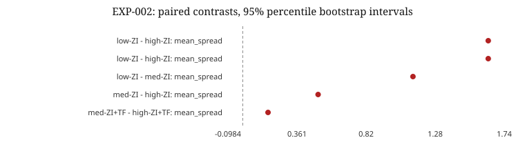
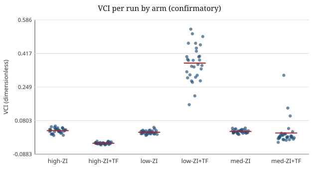
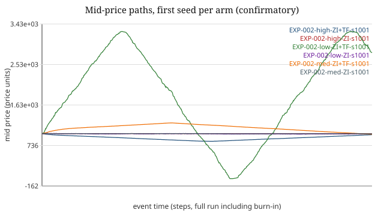

<!-- SPDX-License-Identifier: LicenseRef-MARKET-NC-Research-1.0 -->
# EXP-002: Liquidity supply and spread (report)

**Experiment:** EXP-002. **Date:** 2026-11-25. **Version:** protocol v1.0. **Status:** complete, confirmatory, 180 of 180 planned runs. **Authorship:** Mohamed Bechir Kefi (approved authorship, C3); AI research and development assistant disclosed, not an author. **Protocol SHA-256:** `c2e932dab9514a77fc927b2f20396163e477757bd3a1ff6590fd263343c8d230`. **Code revision:** `26266f2bf6efe2df1e1c1738e9b12e90f169731e`.

## 1. Executive summary

Question: does more limit-order supply by ZI agents narrow the mean quoted spread, and does the TF effect on VCI depend on liquidity? Method: ZI market-order probability 0.35 (low), 0.2 (medium), 0.1 (high) crossed with ZI-only and ZI+TF (70/30), 30 paired seeds. Outcome: low minus high liquidity spread (ZI-only) = 1.632 price units, 95% interval [1.624, 1.641]; H1 (spread lower at high liquidity) is **supported**. Secondary interaction on VCI (medium versus high) = 0.0555, Holm interval [0.03614, 0.08209]. Caveat: the pre-declared degenerate arm low-ZI+TF was flagged in 30 of 30 runs, a model failure for that arm (flag rate above 20%); it is reported and excluded from every contrast (amendment A1).

## 2. Rationale and literature

In random-order double-auction theory more resting limit orders fill the book and narrow the spread (Smith et al. 2003, arXiv cond-mat/0210475). A thin book may amplify the impact of trend-following flow, which motivates the interaction.

## 3. Hypotheses and operational definitions

- Mean quoted spread: mean over two-sided post-burn-in steps of ask - bid (price units = ticks at tick 1).
- Primary: `E[spread(low-ZI) - spread(high-ZI)] > 0` (spread lower at high liquidity). Contradiction: interval entirely below 0.
- Secondary (Holm, D-013 family of 16): level contrasts lower minus higher liquidity within each composition on spread, depth, volume and realised volatility; interaction `[VCI(med-ZI+TF) - VCI(med-ZI)] - [VCI(high-ZI+TF) - VCI(high-ZI)]` (nondirectional).

## 4. Methodology

- Simulation model: `research/protocol.md` sections 3 and 3.6 (frozen v1.0), engine `market.simulate`; metrics `market.metrics` (protocol section 5).
- Frozen config: `experiments/configs/EXP-002.json`, SHA-256 `27df81aeb9d5511c41a0d7fd4adf40ab4f3a6e094d9a0dd523ba864ded29b26a` (copied as [`config.json`](config.json)).
- Seeds: 1001 to 1030, common random numbers across arms. Hardware and software: Apple M1 Pro, 10 cores, Darwin 24.3.0 (macOS-15.3.1-arm64-arm-64bit), Python 3.12.1, numpy 2.5.4, market 0.0.0.
- Execution: `nice -n 10 .venv/bin/python -m market.cli run --exp EXP-002 --workers 2`, through the freeze guard (`market.runner.check_gate`). Batch EXP-002-20261124T233901Z, start 2026-11-24T23:36:32Z, end 2026-11-24T23:39:02Z (UTC), exit code 0, wall time 148.8 s; 180 runs, 0 failed, none dropped. The machine was shared with other sessions (load average up to about 84 during the batches), so runtimes are not benchmark timings.
- Code revision: `26266f2bf6efe2df1e1c1738e9b12e90f169731e` (working tree clean of tracked changes: True). Data manifest SHA-256 `0d78d1707ae5d93f757105eae90f5b0f554cb4993ef0e9e21cb2f28d0799cdab`.
- Per-run provenance: [`provenance.csv`](../../../results/confirmatory/EXP-002/provenance.csv) (run id, config hash, seed, revision, data manifest hash, hardware, batch start and end, runtime, status, result SHA-256). The runner records each run's duration, not its own start and end time; the batch times bound every run.
- Statistics: per-seed paired differences; 95% percentile bootstrap interval of the mean (10,000 resamples, seed 20261124); `d_z` = mean / SD of the differences; analysis module `market.frozen_analysis`, written and committed before any confirmatory output (D-013).
- Other parameters as EXP-001. With common random numbers and identical configs, the med-ZI and med-ZI+TF runs reproduce EXP-001 A0 and A1 exactly (checked: identical VCI for every seed).

## 5. Implementation verification

- Before the runs: 154 tests passed (`.venv/bin/python -m pytest`), all frozen hashes matched `research/freeze.json`, the FI-2010 files matched their SHA-256, and the smoke matrix reproduced journal J-0002 exactly (J-0005).
- Metric validation on known cases: `scripts/validate_metrics.py`, 13 of 13 checks passed (J-0005).
- After adding the analysis module: 163 tests passed (154 plus 9 in `tests/test_frozen_analysis.py`).
- Invariants (conservation of cash and inventory, no negative balance, price-time priority) are checked at the end of every run; a violation fails the run. Every run of this experiment has status `ok`, so every run passed them.

## 6. Execution record and deviations

- All 180 runs completed with status `ok`; none dropped. low-ZI+TF run in full and excluded from contrasts as pre-declared.
- Deviations: none in execution. Holm tie-ordering observation D-014 applies (decisions unaffected).

## 7. Results

### Arm summary

| Arm | Runs | VCI mean (SD) | Realised vol. mean (SD) | Mean spread, price units (SD) | Depth at best (SD) | Volume per step (SD) | Max drawdown (SD) | Mean runtime (s) |
| --- | --- | --- | --- | --- | --- | --- | --- | --- |
| high-ZI | 30 | 0.0298 (0.01247) | 0.0007165 (1.561e-05) | 1.291 (0.01143) | 120.8 (6.762) | 0.5227 (0.004704) | 0.004952 (0.001149) | 1.59 |
| high-ZI+TF | 30 | -0.03352 (0.004799) | 0.0003704 (4.307e-05) | 1.132 (0.005144) | 149.8 (1.829) | 0.8124 (0.008289) | 0.1323 (0.01738) | 1.82 |
| low-ZI | 30 | 0.02165 (0.009086) | 0.002598 (6.674e-05) | 2.923 (0.02446) | 41.59 (1.284) | 1.195 (0.004331) | 0.02138 (0.005369) | 1.67 |
| low-ZI+TF | 30 | 0.3689 (0.08861) | 0.05619 (0.01091) | 3.806 (0.04857) | 14.68 (0.8286) | 1.06 (0.005741) | 0.9996 (9.863e-06) | 1.61 |
| med-ZI | 30 | 0.02564 (0.008298) | 0.001302 (3.39e-05) | 1.792 (0.01671) | 71.1 (1.992) | 0.7873 (0.004209) | 0.01051 (0.002913) | 1.62 |
| med-ZI+TF | 30 | 0.01781 (0.06483) | 0.0005241 (0.0001892) | 1.3 (0.02458) | 109.4 (5.013) | 1.011 (0.005651) | 0.2004 (0.05875) | 1.57 |

### Flags per arm

| Arm | Runs | Failed | Degenerate | One-sided > 5% | < 50 non-zero returns | VCI undefined |
| --- | --- | --- | --- | --- | --- | --- |
| high-ZI | 30 | 0 | 0 | 0 | 0 | 0 |
| high-ZI+TF | 30 | 0 | 0 | 0 | 0 | 0 |
| low-ZI | 30 | 0 | 0 | 0 | 0 | 0 |
| low-ZI+TF | 30 | 0 | 30 | 30 | 0 | 0 |
| med-ZI | 30 | 0 | 0 | 0 | 0 | 0 |
| med-ZI+TF | 30 | 0 | 0 | 0 | 0 | 0 |

Arms with a flag rate above 20% (reported as a model failure for that arm, protocol section 10): low-ZI+TF (100%).

### Primary contrast and sensitivity

| Contrast (treatment minus control) | Metric | Pairs | Mean diff. | d_z | 95% interval |
| --- | --- | --- | --- | --- | --- |
| low-ZI - high-ZI | mean_spread | 30 | 1.632 | 69.3 | [1.624, 1.641] |
| low-ZI - high-ZI | mean_spread | 30 | 1.632 | 69.3 | [1.624, 1.641] |

Flagged runs in low-ZI or high-ZI: 0.

### Secondary contrasts (Holm across 16)

| Contrast (treatment minus control) | Metric | Pairs | Mean diff. | d_z | 95% interval | Holm rank / m | Holm level | Holm interval | Holm p |
| --- | --- | --- | --- | --- | --- | --- | --- | --- | --- |
| low-ZI - med-ZI | mean_spread | 30 | 1.132 | 60.5 | [1.125, 1.138] | 1 / 16 | 0.99687 | [1.121, 1.141] | < 0.0001 |
| low-ZI - med-ZI | mean_depth_at_best | 30 | -29.52 | -12 | [-30.37, -28.67] | 2 / 16 | 0.99667 | [-30.78, -28.24] | < 0.0001 |
| low-ZI - med-ZI | volume_per_step | 30 | 0.4074 | 97.8 | [0.406, 0.4089] | 3 / 16 | 0.99643 | [0.4053, 0.4096] | < 0.0001 |
| low-ZI - med-ZI | realised_volatility | 30 | 0.001296 | 20.5 | [0.001274, 0.001319] | 4 / 16 | 0.99615 | [0.001264, 0.00133] | < 0.0001 |
| low-ZI - high-ZI | mean_depth_at_best | 30 | -79.26 | -10.9 | [-81.8, -76.62] | 5 / 16 | 0.99583 | [-82.83, -75.53] | < 0.0001 |
| low-ZI - high-ZI | volume_per_step | 30 | 0.6721 | 134 | [0.6703, 0.6738] | 6 / 16 | 0.99545 | [0.6695, 0.6746] | < 0.0001 |
| low-ZI - high-ZI | realised_volatility | 30 | 0.001882 | 27.8 | [0.001858, 0.001906] | 7 / 16 | 0.99500 | [0.00185, 0.001916] | < 0.0001 |
| med-ZI - high-ZI | mean_spread | 30 | 0.5009 | 44.8 | [0.4969, 0.5048] | 8 / 16 | 0.99444 | [0.495, 0.5065] | < 0.0001 |
| med-ZI - high-ZI | mean_depth_at_best | 30 | -49.74 | -6.78 | [-52.29, -47.06] | 9 / 16 | 0.99375 | [-53.28, -46.09] | < 0.0001 |
| med-ZI - high-ZI | volume_per_step | 30 | 0.2646 | 93.7 | [0.2636, 0.2656] | 10 / 16 | 0.99286 | [0.2633, 0.2661] | < 0.0001 |
| med-ZI - high-ZI | realised_volatility | 30 | 0.0005851 | 18.6 | [0.0005741, 0.0005962] | 11 / 16 | 0.99167 | [0.0005704, 0.0006002] | < 0.0001 |
| med-ZI+TF - high-ZI+TF | mean_spread | 30 | 0.168 | 7.21 | [0.1604, 0.1767] | 12 / 16 | 0.99000 | [0.158, 0.1795] | < 0.0001 |
| med-ZI+TF - high-ZI+TF | mean_depth_at_best | 30 | -40.42 | -8.38 | [-42.18, -38.81] | 13 / 16 | 0.98750 | [-42.64, -38.41] | < 0.0001 |
| med-ZI+TF - high-ZI+TF | volume_per_step | 30 | 0.1982 | 27.9 | [0.1958, 0.2007] | 14 / 16 | 0.98333 | [0.1953, 0.2013] | < 0.0001 |
| med-ZI+TF - high-ZI+TF | realised_volatility | 30 | 0.0001536 | 0.916 | [0.0001001, 0.0002164] | 15 / 16 | 0.97500 | [9.327e-05, 0.000228] | < 0.0001 |
| [med-ZI+TF - med-ZI] - [high-ZI+TF - high-ZI] | vci (interaction) | 30 | 0.0555 | 0.825 | [0.03614, 0.08209] | 16 / 16 | 0.95000 | [0.03614, 0.08209] | < 0.0001 |

### Figures







## 8. Interpretation

- **Measured:** spread falls monotonically with liquidity supply in the ZI-only market (low - medium 1.132, medium - high 0.5009 price units), and depth rises; this matches the random-order theory and is largely mechanical in this model (a lower market-order probability means more limit orders per step). Volume and realised volatility fall with liquidity.
- **Interaction:** the TF effect on VCI is larger at medium than at high liquidity by 0.0555 (Holm interval excluding 0: True). Because the medium-liquidity TF effect (EXP-001) itself has an interval including 0, this says the TF effect on VCI is lower (more negative) at high liquidity than at medium, not that TF raise clustering at medium liquidity.
- **Expected versus observed:** the primary hypothesis was expected and holds with a very large standardised effect; the low-liquidity TF cell failed as anticipated (price floor, one-sided book).

## 9. Threats to validity

- Liquidity is varied through the ZI market-order probability, which changes aggressive flow and limit supply together. Order lifetime is fixed, so depth also changes. The `tau`-halved sensitivity named in the protocol is exploratory and was not run in M3.
- The degenerate cell describes the price-floor mechanics more than the agents.

## 10. Conclusion and next experiment

Within this model, more ZI limit supply narrows the spread (verdict: supported). The interaction suggests liquidity modulates the TF effect on clustering; a dedicated study would vary liquidity without changing aggressive flow (for example through order lifetime).

## 11. Reproduction appendix

```
/Users/bechir/research/labs/.tools/py/bin/uv sync --frozen --all-groups --all-extras
.venv/bin/python -m pytest
.venv/bin/python -m market.cli run --exp EXP-002 --workers 2
.venv/bin/python -m market.cli report --exp EXP-002 --control high-ZI
.venv/bin/python -m market.frozen_analysis --exp EXP-002
.venv/bin/python scripts/write_m3_reports.py
```

Raw results: [`results/confirmatory/EXP-002/`](../../../results/confirmatory/EXP-002/) (schema `market.run_result` 1.0.0 per run, `run_manifest.json`, `metrics.csv`, `analysis.json`, tables, figures); checksums in `SHA256SUMS` there. The simulation is deterministic given the seed and the code revision: a rerun at the recorded revision reproduces each run's metrics exactly (the smoke check in J-0005 reproduced J-0002 bit for bit).

Verified references used in this report are listed in `research/literature_review.md` (sources opened 2026-11-24).

## 12. Links

[`config.json`](config.json), [`run_manifest.json`](run_manifest.json), [`metrics.csv`](metrics.csv), [`figures/`](figures/), [`reproduction.md`](reproduction.md), [`analysis.json`](../../../results/confirmatory/EXP-002/analysis.json).
