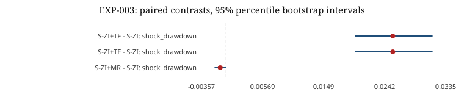
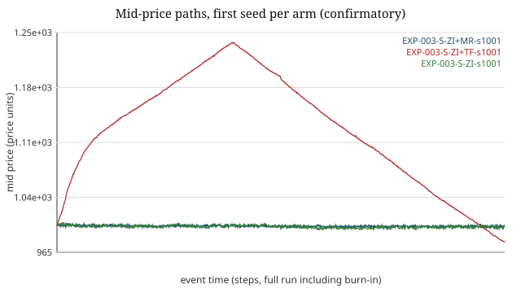

<!-- SPDX-License-Identifier: LicenseRef-MARKET-NC-Research-1.0 -->
# EXP-003: Response to an exogenous sell shock (report)

**Experiment:** EXP-003 (optional, amendment A3; run in full). **Date:** 2026-11-25. **Version:** protocol v1.0. **Status:** complete, confirmatory, 90 of 90 planned runs. **Authorship:** Mohamed Bechir Kefi, independent researcher (approved authorship, C3); AI research and development assistant disclosed, not an author. **Protocol SHA-256:** `f535bd42ba3afa5320088c0ed811f50f2966a69ef0bcd82c34644b9537f607c4`. **Code revision:** `26266f2bf6efe2df1e1c1738e9b12e90f169731e`.

## 1. Executive summary

Question: after one market sell of 50% of resting bid depth at step 50,000, do mixtures differ in drawdown and recovery? Outcome: post-shock maximum drawdown (5,000-step window) is larger with trend followers: S-ZI+TF minus S-ZI = 0.02545 (fraction of the pre-shock mid), 95% interval [0.01976, 0.03148], d_z = 1.52; H1 is **supported**. Mean reverters: -0.0007314, Holm interval [-0.00159, 0.0001319] (secondary). Caveat: bid depth at the shock differs between arms, and the TF arm's larger drawdown also reflects its larger ordinary drawdowns (EXP-001).

## 2. Rationale and literature

Trend followers may extend a shock-induced fall (positive feedback) and mean reverters may buy into it (negative feedback); the ZI-only market gives the mechanical response of the book.

## 3. Hypotheses and operational definitions

- Drawdown = max(0, 1 - min(mid over the 5,000 steps after the shock) / pre-shock mid). H1: `E[DD(S-ZI+TF) - DD(S-ZI)] > 0`.
- Recovery = steps after the shock until the mid returns within 1% of the pre-shock mid after having left that band (0 if it never leaves the band), censored at 20,000 steps; descriptive (Kaplan-Meier).
- Secondary: S-ZI+MR minus S-ZI drawdown (nondirectional), Holm family m = 1 (D-013).

## 4. Methodology

- Simulation model: `research/protocol.md` sections 3 and 3.6 (frozen v1.0), engine `market.simulate`; metrics `market.metrics` (protocol section 5).
- Frozen config: `experiments/configs/EXP-003.json`, SHA-256 `88fa0f05dff6775233c13804717781dcd7bf4a7a0d8d632a420737ea4965f3d4` (copied as [`config.json`](config.json)).
- Seeds: 1001 to 1030, common random numbers across arms. Hardware and software: Apple M1 Pro, 10 cores, Darwin 24.3.0 (macOS-15.3.1-arm64-arm-64bit), Python 3.12.1, numpy 2.5.4, market 0.0.0.
- Execution: `nice -n 10 .venv/bin/python -m market.cli run --exp EXP-003 --workers 2`, through the freeze guard (`market.runner.check_gate`). Batch EXP-003-20261124T234015Z, start 2026-11-24T23:39:02Z, end 2026-11-24T23:40:15Z (UTC), exit code 0, wall time 73.3 s; 90 runs, 0 failed, none dropped. The machine was shared with other sessions (load average up to about 84 during the batches), so runtimes are not benchmark timings.
- Code revision: `26266f2bf6efe2df1e1c1738e9b12e90f169731e` (working tree clean of tracked changes: True). Data manifest SHA-256 `0d78d1707ae5d93f757105eae90f5b0f554cb4993ef0e9e21cb2f28d0799cdab`.
- Per-run provenance: [`provenance.csv`](../../../results/confirmatory/EXP-003/provenance.csv) (run id, config hash, seed, revision, data manifest hash, hardware, batch start and end, runtime, status, result SHA-256). The runner records each run's duration, not its own start and end time; the batch times bound every run.
- Statistics: per-seed paired differences; 95% percentile bootstrap interval of the mean (10,000 resamples, seed 20261124); `d_z` = mean / SD of the differences; analysis module `market.frozen_analysis`, written and committed before any confirmatory output (D-013).
- Shock: a dedicated agent outside the 100 sends one market sell of floor(0.5 x resting bid depth) at step 50,000; its cash and inventory enter the conservation checks.

## 5. Implementation verification

- Before the runs: 154 tests passed (`.venv/bin/python -m pytest`), all frozen hashes matched `research/freeze.json`, the FI-2010 files matched their SHA-256, and the smoke matrix reproduced journal J-0002 exactly (J-0005).
- Metric validation on known cases: `scripts/validate_metrics.py`, 13 of 13 checks passed (J-0005).
- After adding the analysis module: 163 tests passed (154 plus 9 in `tests/test_frozen_analysis.py`).
- Invariants (conservation of cash and inventory, no negative balance, price-time priority) are checked at the end of every run; a violation fails the run. Every run of this experiment has status `ok`, so every run passed them.

## 6. Execution record and deviations

- All 90 runs `ok`; none dropped; no shock window truncated.
- **Gap (D-013):** the protocol's secondary outcome "spread widening" has no per-run metric and no formula; it was not measured. Defining it now would be a post-hoc choice. Owner decision (2026-11-25, "approve all recommendations, RIGGED A", D-015): "It is reported as not measured, because the protocol gives no formula. No metric is defined after the data."

## 7. Results

### Arm summary (whole run)

| Arm | Runs | VCI mean (SD) | Realised vol. mean (SD) | Mean spread, price units (SD) | Depth at best (SD) | Volume per step (SD) | Max drawdown (SD) | Mean runtime (s) |
| --- | --- | --- | --- | --- | --- | --- | --- | --- |
| S-ZI | 30 | 0.02616 (0.008723) | 0.001307 (3.396e-05) | 1.793 (0.017) | 70.65 (2.024) | 0.7959 (0.004071) | 0.012 (0.003819) | 1.67 |
| S-ZI+MR | 30 | 0.04449 (0.01751) | 0.001402 (3.946e-05) | 2.77 (0.02992) | 239.6 (21) | 1.011 (0.004477) | 0.006981 (0.001104) | 1.58 |
| S-ZI+TF | 30 | 0.0283 (0.0615) | 0.0005681 (0.000211) | 1.312 (0.02661) | 106.4 (6.072) | 1.016 (0.005754) | 0.2198 (0.05862) | 1.6 |

### Primary contrast and sensitivity

| Role | Contrast (treatment minus control) | Metric | Pairs | Mean diff. | d_z | 95% interval |
| --- | --- | --- | --- | --- | --- | --- |
| primary | S-ZI+TF - S-ZI | shock_drawdown | 30 | 0.02545 | 1.52 | [0.01976, 0.03148] |
| sensitivity: flagged runs and partners excluded | S-ZI+TF - S-ZI | shock_drawdown | 30 | 0.02545 | 1.52 | [0.01976, 0.03148] |

### Secondary contrast

| Contrast (treatment minus control) | Metric | Pairs | Mean diff. | d_z | 95% interval | Holm rank / m | Holm level | Holm interval | Holm p |
| --- | --- | --- | --- | --- | --- | --- | --- | --- | --- |
| S-ZI+MR - S-ZI | shock_drawdown | 30 | -0.0007314 | -0.295 | [-0.00159, 0.0001319] | 1 / 1 | 0.95000 | [-0.00159, 0.0001319] | 0.0932 |

### Recovery (descriptive) and covariate

| Arm | Runs | Recovered (events) | Censored at 20,000 steps | Kaplan-Meier median recovery (steps) | Bid depth at shock, mean (SD) |
| --- | --- | --- | --- | --- | --- |
| S-ZI | 30 | 30 | 0 | 0 | 1551 (94.86) |
| S-ZI+TF | 30 | 23 | 7 | 1,537 | 1285 (564.9) |
| S-ZI+MR | 30 | 30 | 0 | 0 | 1191 (123.2) |

A Kaplan-Meier median of 0 means that in at least half of the runs the mid never left the 1% band after the shock.

### Flags

| Arm | Runs | Failed | Degenerate | One-sided > 5% | < 50 non-zero returns | VCI undefined |
| --- | --- | --- | --- | --- | --- | --- |
| S-ZI | 30 | 0 | 0 | 0 | 0 | 0 |
| S-ZI+MR | 30 | 0 | 0 | 0 | 0 | 0 |
| S-ZI+TF | 30 | 0 | 0 | 0 | 0 | 0 |

### Figures





## 8. Interpretation

- **Measured:** with TF the shock is followed by a deeper fall and, in 7 of 30 runs, no return within 1% inside 20,000 steps; in the ZI-only and MR markets the shock is mostly absorbed within the band.
- **Alternative explanations:** TF markets have lower and more variable bid depth at the shock (table), and large drawdowns occur in TF markets without any shock (EXP-001 A1 maximum drawdown about 0.2 over the run). Part of the post-shock difference may be ordinary TF excursions overlapping the window rather than a response to the shock. The design has no unshocked TF control in the same window.

- **M4 note (exploratory, journal J-0011, D-016; not confirmatory):** on development seeds 101 to 130, the same window drawdown without a shock gives A1 - A0 = 0.007912 [0.004752, 0.01107], and the difference-in-differences [S-ZI+TF - A1] - [S-ZI - A0] is 0.01616 [0.009609, 0.02483]: ordinary TF excursions account for part, not all, of the shocked contrast. In the committed runs the shock was fully filled in every run, and within S-ZI+TF the drawdown is nearly unrelated to bid depth at the shock (Spearman 0.07141).

## 9. Threats to validity

- One shock size and time; the 25% shock sensitivity in the protocol is exploratory and was not run. Spread widening not measured.
- Recovery depends on the 1% band and the 20,000-step cap; censoring is reported.

## 10. Conclusion and next experiment

Within this model, markets with 30% trend followers show larger post-shock drawdowns than ZI-only markets (verdict: supported). Separating shock response from ordinary TF excursions needs an unshocked control window (the difference-in-differences of drawdown with and without the shock on the same seeds).

## 11. Reproduction appendix

```
uv sync --frozen --all-groups --all-extras
.venv/bin/python -m pytest
.venv/bin/python -m market.cli run --exp EXP-003 --workers 2
.venv/bin/python -m market.cli report --exp EXP-003 --control S-ZI
.venv/bin/python -m market.frozen_analysis --exp EXP-003
.venv/bin/python scripts/write_m3_reports.py
```

Raw results: [`results/confirmatory/EXP-003/`](../../../results/confirmatory/EXP-003/) (schema `market.run_result` 1.0.0 per run, `run_manifest.json`, `metrics.csv`, `analysis.json`, tables, figures); checksums in `SHA256SUMS` there. The simulation is deterministic given the seed and the code revision: a rerun at the recorded revision reproduces each run's metrics exactly (the smoke check in J-0005 reproduced J-0002 bit for bit).

Verified references used in this report are listed in `research/literature_review.md` (sources opened 2026-11-24).

## 12. Links

[`config.json`](config.json), [`run_manifest.json`](run_manifest.json), [`metrics.csv`](metrics.csv), [`figures/`](figures/), [`reproduction.md`](reproduction.md), [`analysis.json`](../../../results/confirmatory/EXP-003/analysis.json).
