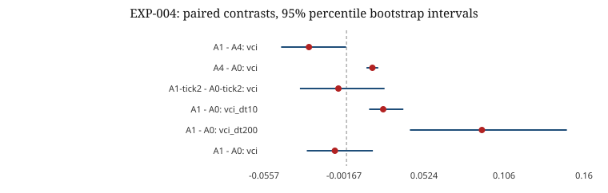
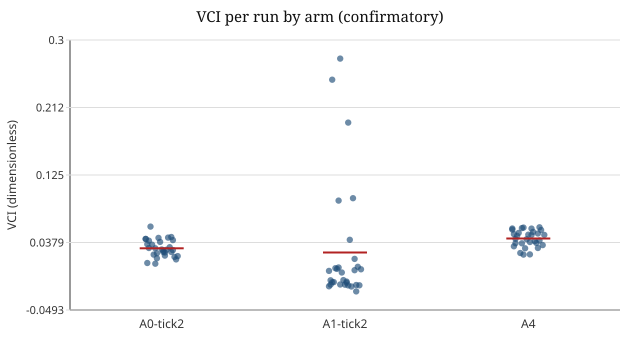

<!-- SPDX-License-Identifier: LicenseRef-MARKET-NC-Research-1.0 -->
# EXP-004: Sensitivity analyses that could invalidate EXP-001 (report)

**Experiment:** EXP-004. **Date:** 2026-11-25. **Version:** protocol v1.0. **Status:** complete, confirmatory, 90 of 90 planned new runs plus the EXP-001 reanalysis. **Authorship:** Mohamed Bechir Kefi (approved authorship, C3); AI research and development assistant disclosed, not an author. **Protocol SHA-256:** `abe44221155d0d5de42eec66db5038589b762fbdf24a9120fa1dbd7257d6e322`. **Code revision:** `26266f2bf6efe2df1e1c1738e9b12e90f169731e`.

## 1. Executive summary

Question: is any VCI change from trend followers (EXP-001) attributable to price feedback rather than aggressiveness, the sampling interval or the tick? EXP-001's primary contrast was -0.007825 [-0.0268, 0.01785] (inconclusive). Placebo: VCI(A1) - VCI(A4) = -0.02534 [-0.04414, -0.0002837], so the aggressiveness-matched coin-flip agents raised clustering more than the trend followers. Sampling interval: A1 - A0 is 0.02481 [0.0153, 0.03842] at `dt` = 10 and 0.0915 [0.04287, 0.1489] at `dt` = 200. Tick 2: -0.005427 [-0.03144, 0.02572]. Frozen robustness rule: **invalidated (a sign reversal with an interval excluding 0)**. Placebo rule: placebo contrast contradicted; EXP-001 does not support H1 (verdict inconclusive), so the attribution rule is not triggered.

## 2. Rationale

Trend followers differ from ZI agents both in conditioning on prices and in their mix of order types. Without a placebo matched on aggressiveness, a VCI change cannot be attributed to feedback; sampling interval and tick are discretisation choices that could create or hide an effect.

## 3. Hypotheses and decision rules (frozen)

- Placebo: H0 `E[VCI(A1) - VCI(A4)] = 0`, H1 `> 0`. If the interval includes 0 while EXP-001 supports H1, the EXP-001 effect is not attributable to trend feedback.
- `dt` and tick: the EXP-001 contrast is robust only if its sign is the same and its interval excludes 0 at both `dt` values and at tick 2. A sign reversal invalidates the main interpretation; an interval including 0 qualifies it. "Same sign" is taken relative to the EXP-001 primary mean difference (D-013).
- Exclusion: the EXP-001 primary contrast without flagged runs and their partners.

## 4. Methodology

- Simulation model: `research/protocol.md` sections 3 and 3.6 (frozen v1.0), engine `market.simulate`; metrics `market.metrics` (protocol section 5).
- Frozen config: `experiments/configs/EXP-004.json`, SHA-256 `6ae660808275162428a1b40f0ea14b795d9cfa4c9267400aa04b363eef7721a2` (copied as [`config.json`](config.json)).
- Seeds: 1001 to 1030, common random numbers across arms. Hardware and software: Apple M1 Pro, 10 cores, Darwin 24.3.0 (macOS-15.3.1-arm64-arm-64bit), Python 3.12.1, numpy 2.5.4, market 0.0.0.
- Execution: `nice -n 10 .venv/bin/python -m market.cli run --exp EXP-004 --workers 2`, through the freeze guard (`market.runner.check_gate`). Batch EXP-004-20261124T234124Z, start 2026-11-24T23:40:15Z, end 2026-11-24T23:41:24Z (UTC), exit code 0, wall time 68.8 s; 90 runs, 0 failed, none dropped. The machine was shared with other sessions (load average up to about 84 during the batches), so runtimes are not benchmark timings.
- Code revision: `26266f2bf6efe2df1e1c1738e9b12e90f169731e` (working tree clean of tracked changes: True). Data manifest SHA-256 `0d78d1707ae5d93f757105eae90f5b0f554cb4993ef0e9e21cb2f28d0799cdab`.
- Per-run provenance: [`provenance.csv`](../../../results/confirmatory/EXP-004/provenance.csv) (run id, config hash, seed, revision, data manifest hash, hardware, batch start and end, runtime, status, result SHA-256). The runner records each run's duration, not its own start and end time; the batch times bound every run.
- Statistics: per-seed paired differences; 95% percentile bootstrap interval of the mean (10,000 resamples, seed 20261124); `d_z` = mean / SD of the differences; analysis module `market.frozen_analysis`, written and committed before any confirmatory output (D-013).
- Arms: A4 (70 ZI + 30 PA, `pa_skip_prob` = 0), A0-tick2 and A1-tick2 (tick 2, all else equal). The placebo and `dt` components pair these runs with the EXP-001 runs on the same seeds (common random numbers).

## 5. Implementation verification

- Before the runs: 154 tests passed (`.venv/bin/python -m pytest`), all frozen hashes matched `research/freeze.json`, the FI-2010 files matched their SHA-256, and the smoke matrix reproduced journal J-0002 exactly (J-0005).
- Metric validation on known cases: `scripts/validate_metrics.py`, 13 of 13 checks passed (J-0005).
- After adding the analysis module: 163 tests passed (154 plus 9 in `tests/test_frozen_analysis.py`).
- Invariants (conservation of cash and inventory, no negative balance, price-time priority) are checked at the end of every run; a violation fails the run. Every run of this experiment has status `ok`, so every run passed them.

## 6. Execution record and deviations

- All 90 new runs `ok`; none dropped. No flagged runs in EXP-001 A0 or A1, so the exclusion component equals the primary analysis.
- Deviations: none.

## 7. Results

### Arm summary (new runs)

| Arm | Runs | VCI mean (SD) | Realised vol. mean (SD) | Mean spread, price units (SD) | Depth at best (SD) | Volume per step (SD) | Max drawdown (SD) | Mean runtime (s) |
| --- | --- | --- | --- | --- | --- | --- | --- | --- |
| A0-tick2 | 30 | 0.0304 (0.0112) | 0.001292 (3.38e-05) | 2.465 (0.01561) | 236.2 (10.41) | 0.8022 (0.004329) | 0.007107 (0.001623) | 1.61 |
| A1-tick2 | 30 | 0.02497 (0.07874) | 0.0006509 (0.0002677) | 2.103 (0.02652) | 213.1 (10.35) | 0.9079 (0.01916) | 0.1413 (0.08982) | 1.4 |
| A4 | 30 | 0.04315 (0.01064) | 0.001141 (2.967e-05) | 1.9 (0.0273) | 68.28 (2.009) | 1.01 (0.003866) | 0.01247 (0.00351) | 1.52 |

### Components

| Contrast (treatment minus control) | Metric | Pairs | Mean diff. | d_z | 95% interval |
| --- | --- | --- | --- | --- | --- |
| A1 - A4 | vci | 30 | -0.02534 | -0.402 | [-0.04414, -0.0002837] |
| A4 - A0 | vci | 30 | 0.01751 | 1.54 | [0.0135, 0.02148] |
| A1-tick2 - A0-tick2 | vci | 30 | -0.005427 | -0.0656 | [-0.03144, 0.02572] |
| A1 - A0 | vci_dt10 | 30 | 0.02481 | 0.728 | [0.0153, 0.03842] |
| A1 - A0 | vci_dt200 | 30 | 0.0915 | 0.608 | [0.04287, 0.1489] |
| A1 - A0 | vci | 30 | -0.007825 | -0.121 | [-0.0268, 0.01785] |

### Robustness rule

| Component | Mean diff. | 95% interval | Same sign as EXP-001 | Interval excludes 0 |
| --- | --- | --- | --- | --- |
| sampling interval vci_dt10 | 0.02481 | [0.0153, 0.03842] | False | True |
| sampling interval vci_dt200 | 0.0915 | [0.04287, 0.1489] | False | True |
| tick 2: A1-tick2 minus A0-tick2 | -0.005427 | [-0.03144, 0.02572] | True | False |

### Flags

| Arm | Runs | Failed | Degenerate | One-sided > 5% | < 50 non-zero returns | VCI undefined |
| --- | --- | --- | --- | --- | --- | --- |
| A0-tick2 | 30 | 0 | 0 | 0 | 0 | 0 |
| A1-tick2 | 30 | 0 | 0 | 0 | 0 | 0 |
| A4 | 30 | 0 | 0 | 0 | 0 | 0 |

### Figures





## 8. Interpretation

- **Placebo:** the EXP-001 primary contrast was inconclusive, so the attribution rule is not triggered. The placebo contrast itself is negative with an interval that just excludes 0 (upper end -0.0002837): at `dt` = 50 price-independent aggressive flow produced more clustering than trend-following flow of the same aggressiveness.
- **Sampling interval:** the A1 - A0 contrast is positive with intervals excluding 0 at `dt` = 10 and 200 but has a negative point estimate with an interval including 0 at `dt` = 50. Because the primary estimate is close to 0, its "sign" is weakly determined; the frozen rule nonetheless returns "invalidated (a sign reversal with an interval excluding 0)", and the report states it as such: the EXP-001 conclusion depends on the sampling interval.
- **Tick:** at tick 2 the contrast is -0.005427 with an interval including 0, consistent with the tick-1 primary result.
- **Expected versus observed:** EXP-004 was designed to test a positive EXP-001 effect. With an inconclusive primary result, its main contribution is that the TF effect on clustering is horizon-dependent and that aggressiveness alone raises VCI at `dt` = 50.

## 9. Threats to validity

- PA agents match TF order-type probability and size, but not TF timing (TF skip on a zero signal: 0.45% of activations on average in confirmatory A1, below the 5% threshold) or the serial correlation of TF direction, which is the feedback itself.
- Three sampling intervals only; the pattern across `dt` is not a curve.

## 10. Conclusion and next experiment

Under the frozen rules the EXP-001 result is not robust to the sampling interval. A pre-registered `dt` grid with placebo arms at each interval is the natural next study.

## 11. Reproduction appendix

```
/Users/bechir/research/labs/.tools/py/bin/uv sync --frozen --all-groups --all-extras
.venv/bin/python -m pytest
.venv/bin/python -m market.cli run --exp EXP-004 --workers 2
.venv/bin/python -m market.cli report --exp EXP-004 --control A0-tick2
.venv/bin/python -m market.frozen_analysis --exp EXP-004   # needs the EXP-001 results
.venv/bin/python scripts/write_m3_reports.py
```

Raw results: [`results/confirmatory/EXP-004/`](../../../results/confirmatory/EXP-004/) (schema `market.run_result` 1.0.0 per run, `run_manifest.json`, `metrics.csv`, `analysis.json`, tables, figures); checksums in `SHA256SUMS` there. The simulation is deterministic given the seed and the code revision: a rerun at the recorded revision reproduces each run's metrics exactly (the smoke check in J-0005 reproduced J-0002 bit for bit).

Verified references used in this report are listed in `research/literature_review.md` (sources opened 2026-11-24).

## 12. Links

[`config.json`](config.json), [`run_manifest.json`](run_manifest.json), [`metrics.csv`](metrics.csv), [`figures/`](figures/), [`reproduction.md`](reproduction.md), [`analysis.json`](../../../results/confirmatory/EXP-004/analysis.json).
