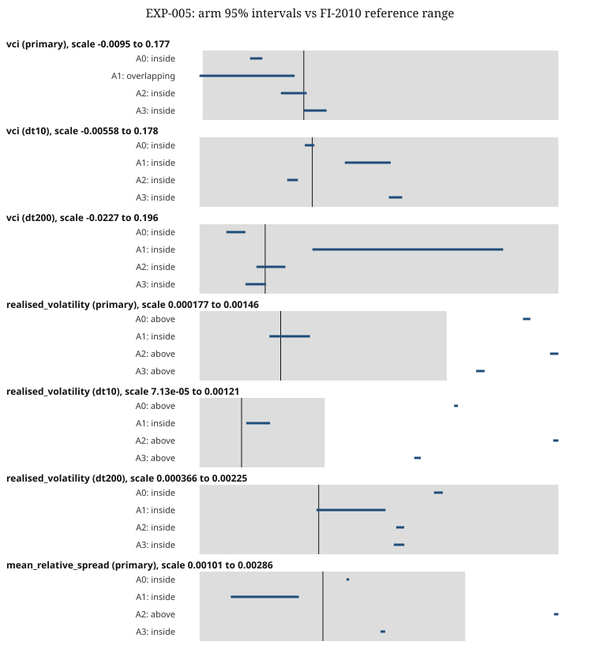

<!-- SPDX-License-Identifier: LicenseRef-MARKET-NC-Research-1.0 -->
# EXP-005: Simulated and real-market volatility, spread and clustering (FI-2010) (report)

**Experiment:** EXP-005 (secondary, descriptive). **Date:** 2026-11-25. **Version:** protocol v1.0. **Status:** complete, confirmatory (0 new runs; uses the 120 EXP-001 runs). **Authorship:** Mohamed Bechir Kefi, independent researcher (approved authorship, C3); AI research and development assistant disclosed, not an author. **Protocol SHA-256:** `d91a4421abeb203af68b4a6c3467aebd69737c9ef55c1897eb4d92d31d4c0fa3`. **Config SHA-256:** `848e9e17a03b31964a7fab5d43b97d9b6004447a3b289f7427b38899e5490719`. **Code revision:** `26266f2bf6efe2df1e1c1738e9b12e90f169731e`.

## 1. Executive summary

Question: where do the EXP-001 simulated markets sit relative to one real limit-order market (FI-2010, five Helsinki stocks, June 2010) on VCI, realised volatility and relative spread, and is real VCI positive on a held-out day? (a) Held-out check: day-10 VCI at h = 5 per stock = -0.001241, 0.03691, 0.05438, 0.03336, 0.07877; VCI positive in all five stocks: **False**, so hypothesis (a) is **not supported** (one stock has a VCI just below 0). Share of day-10 stock values inside the reference range: VCI 80%, realised volatility 100%, relative spread 80%. (b) Placement at the primary sampling: inside: A0 vci, A0 mean_relative_spread, A1 realised_volatility, A1 mean_relative_spread, A2 vci, A3 vci, A3 mean_relative_spread; above: A0 realised_volatility, A2 realised_volatility, A2 mean_relative_spread, A3 realised_volatility; overlapping: A1 vci. This is descriptive only, never validation of the model, and does not change the EXP-001 verdict.

## 2. Rationale and literature

Random-order markets reproduce much of the spread and diffusion of real books (Farmer, Patelli and Zovko 2005); clustering is a stylized fact of real returns (Cont 2001). FI-2010: Ntakaris et al., doi:10.1002/for.2543, data CC BY 4.0.

## 3. Hypotheses and definitions

- (a) On day 10 (held-out file), VCI at h = 5 columns is positive in each of the five stocks; not supported if any is <= 0 or undefined.
- (b) For each EXP-001 arm and statistic, the 95% percentile bootstrap interval of the arm mean (30 seeds, 10,000 resamples, seed 20261124) is classified against the reference [min, max] over 37 blocks of days 1 to 9 as inside, overlapping, below or above; `dt` 10 / h 1 and `dt` 200 / h 20 are sensitivity rows.

## 4. Methodology

- Command: `nice -n 10 .venv/bin/python -m market.cli realdata compare --exp EXP-005` (gated: the protocol and config must match the freeze record and the inputs must be confirmatory EXP-001 results). Run at 2026-11-24T23:41:08Z to 2026-11-24T23:41:08Z UTC, exit code 0, at revision `26266f2bf6efe2df1e1c1738e9b12e90f169731e`, while the EXP-004 batch was still running (three processes in total for about one second).
- Data: FI-2010 NoAuction DecPre fold 9; reference file SHA-256 `f46b3dd6f299dd1179f342b27ac81545747607e227fdd7510482f57d405ca02a`, held-out file SHA-256 `c09785b0aed0825ad566f8fe33a3b7d8c3fbb8993856d162976cb4e1c410aca0` (both checked before the run and by the command itself). Held-out ingestion counts: {"columns": 31937, "missing": 0, "non_positive_price": 0, "crossed_or_locked": 0, "kept": 31937, "segments": 5}.
- Reference values were fitted before the freeze on days 1 to 9 only (J-0004); nothing was refitted.

## 5. Implementation verification

- `tests/test_realdata.py` (fixture-based ingestion, segmentation, block statistics and placement) is part of the 163 passing tests. The held-out file gave exactly 5 segments, as the fail-closed rule requires.

## 6. Execution record and deviations

- One execution, no retry. Deviations: none. The compare command ran concurrently with the last seconds of EXP-004 (a third process), above the brief's two-worker limit for about one second; no result is affected.

## 7. Results

| Arm | Statistic | Sampling | Arm mean | 95% interval | Reference median | Reference [min, max] | Placement |
| --- | --- | --- | --- | --- | --- | --- | --- |
| A0 | vci | primary | 0.02564 | [0.02274, 0.02855] | 0.0481 | [0.0004353, 0.168] | inside |
| A0 | vci | dt10 | 0.054 | [0.05172, 0.05617] | 0.05524 | [0.002767, 0.1696] | inside |
| A0 | vci | dt200 | 0.007273 | [0.002086, 0.01264] | 0.0236 | [-0.01278, 0.186] | inside |
| A0 | realised_volatility | primary | 0.001302 | [0.001289, 0.001314] | 0.0004999 | [0.0002354, 0.001041] | above |
| A0 | realised_volatility | dt10 | 0.0008644 | [0.0008588, 0.0008701] | 0.0002446 | [0.0001232, 0.0004851] | above |
| A0 | realised_volatility | dt200 | 0.001593 | [0.001572, 0.001614] | 0.001021 | [0.0004513, 0.002166] | inside |
| A0 | mean_relative_spread | primary | 0.001791 | [0.001785, 0.001797] | 0.001675 | [0.001098, 0.00234] | inside |
| A1 | vci | primary | 0.01781 | [-0.001045, 0.04381] | 0.0481 | [0.0004353, 0.168] | overlapping |
| A1 | vci | dt10 | 0.07881 | [0.07035, 0.09173] | 0.05524 | [0.002767, 0.1696] | inside |
| A1 | vci | dt200 | 0.09877 | [0.04976, 0.1554] | 0.0236 | [-0.01278, 0.186] | inside |
| A1 | realised_volatility | primary | 0.0005241 | [0.000463, 0.0005953] | 0.0004999 | [0.0002354, 0.001041] | inside |
| A1 | realised_volatility | dt10 | 0.0002904 | [0.0002581, 0.0003271] | 0.0002446 | [0.0001232, 0.0004851] | inside |
| A1 | realised_volatility | dt200 | 0.00116 | [0.00101, 0.00134] | 0.001021 | [0.0004513, 0.002166] | inside |
| A1 | mean_relative_spread | primary | 0.001394 | [0.001244, 0.001562] | 0.001675 | [0.001098, 0.00234] | inside |
| A2 | vci | primary | 0.0435 | [0.03731, 0.04942] | 0.0481 | [0.0004353, 0.168] | inside |
| A2 | vci | dt10 | 0.046 | [0.04356, 0.04849] | 0.05524 | [0.002767, 0.1696] | inside |
| A2 | vci | dt200 | 0.02656 | [0.01873, 0.03478] | 0.0236 | [-0.01278, 0.186] | inside |
| A2 | realised_volatility | primary | 0.001391 | [0.001378, 0.001405] | 0.0004999 | [0.0002354, 0.001041] | above |
| A2 | realised_volatility | dt10 | 0.001153 | [0.001145, 0.00116] | 0.0002446 | [0.0001232, 0.0004851] | above |
| A2 | realised_volatility | dt200 | 0.00141 | [0.001391, 0.001429] | 0.001021 | [0.0004513, 0.002166] | inside |
| A2 | mean_relative_spread | primary | 0.002765 | [0.002755, 0.002776] | 0.001675 | [0.001098, 0.00234] | above |
| A3 | vci | primary | 0.05315 | [0.04789, 0.05885] | 0.0481 | [0.0004353, 0.168] | inside |
| A3 | vci | dt10 | 0.0939 | [0.0908, 0.09703] | 0.05524 | [0.002767, 0.1696] | inside |
| A3 | vci | dt200 | 0.01819 | [0.01266, 0.02405] | 0.0236 | [-0.01278, 0.186] | inside |
| A3 | realised_volatility | primary | 0.001151 | [0.001137, 0.001164] | 0.0004999 | [0.0002354, 0.001041] | above |
| A3 | realised_volatility | dt10 | 0.000753 | [0.0007436, 0.0007625] | 0.0002446 | [0.0001232, 0.0004851] | above |
| A3 | realised_volatility | dt200 | 0.001405 | [0.001379, 0.00143] | 0.001021 | [0.0004513, 0.002166] | inside |
| A3 | mean_relative_spread | primary | 0.001955 | [0.001944, 0.001966] | 0.001675 | [0.001098, 0.00234] | inside |



## 8. Interpretation

- **Held-out check:** four of five stocks show positive clustering on day 10; one is slightly negative. A single day per stock (1,888 to 13,378 columns) gives noisy VCI estimates, so this is weak evidence either way about the real market's clustering on that day; the directional hypothesis as frozen is not supported.
- **Placement:** all four simulated arms have VCI inside or overlapping the real reference range, which is wide. Realised volatility at the primary sampling is above the real range for A0, A2 and A3 and inside it for A1; the relative spread is inside the range for A0, A1 and A3 and above it for A2. These placements depend on the crude clock match (1 step against 1 event) and on the tick-to-price ratio, and say nothing about the model being a good description of the market.
- Expected versus observed: no directional expectation for (b); (a) expected positive VCI in every stock and was not met in one.

## 9. Threats to validity

- One market, ten days, five stocks; clock mismatch; tick-to-price differences; reference blocks may contain overnight returns at unknown positions (`research/limitations.md`).

## 10. Conclusion

The simulated arms produce clustering, volatility and spread of the same order of magnitude as FI-2010 under this clock match, with arm-specific departures. This comparison is descriptive and leaves the EXP-001 verdict unchanged.

## 11. Reproduction appendix

```
python3 -I scripts/download_fi2010.py   # only if data/raw/fi2010/ is missing; checks SHA-256
.venv/bin/python -m market.cli realdata compare --exp EXP-005 --results results/confirmatory/EXP-001
.venv/bin/python scripts/write_m3_reports.py
```

Raw output: [`comparison.json`](../../../results/confirmatory/EXP-005/comparison.json); checksums in `results/confirmatory/EXP-005/SHA256SUMS`.

## 12. Links

[`config.json`](config.json), [`figures/`](figures/), [`reproduction.md`](reproduction.md). EXP-005 has no runs of its own; the run manifest and metrics are those of EXP-001 ([`../EXP-001/run_manifest.json`](../EXP-001/run_manifest.json)).
