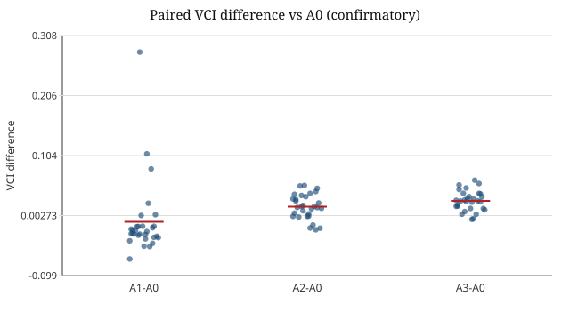
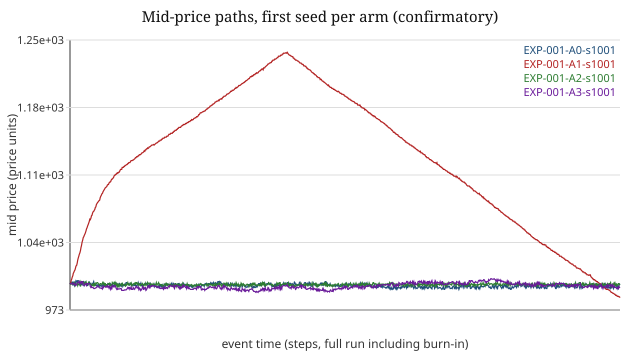
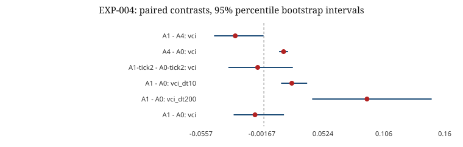
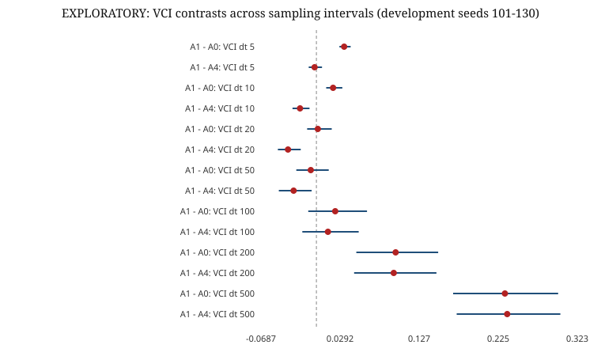

<!-- SPDX-License-Identifier: LicenseRef-MARKET-NC-Research-1.0 -->

**Status.** Independent research manuscript / preprint draft, not peer-reviewed. Not submitted anywhere. Author and affiliation metadata are as approved by the owner (authorship decision C3); no institutional affiliation, funding or endorsement is claimed.

# Abstract

Random-order ("zero-intelligence") order flow in a continuous double auction already reproduces much of the spread and diffusion behaviour of real order books, and models with chartist traders have attributed volatility clustering to trend-following feedback. We ask, in a small, fully tested limit-order-book simulation with price-time priority and cash and inventory constraints, whether replacing 30% of random-order agents by trend followers raises volatility clustering, measured by the mean autocorrelation of absolute mid-price returns over lags 1 to 10 (VCI). The protocol, including an aggressiveness-matched placebo arm and sensitivity analyses, was frozen before any confirmatory run; 480 runs on 30 paired seeds were executed with no failure. The frozen verdict is that the primary interpretation is invalidated: the frozen robustness rule found a sign reversal, because the trend-follower contrast was positive, with intervals excluding 0, at sampling intervals of 10 and 200 steps, while at the primary interval of 50 steps the paired VCI difference was -0.007825 (95% bootstrap interval [-0.0268, 0.01785]), inconclusive on its own. The rule takes its sign reference from that near-zero primary estimate. As a secondary reading only, taking the sign of H1 as the reference would make the same rule return "qualified" rather than "invalidated"; both readings agree that the answer depends on the sampling interval. At 50 steps, price-independent aggressive agents raised VCI (placebo minus baseline 0.01751, [0.0135, 0.02148]), and trend followers added nothing beyond them (A1 minus placebo -0.02534, [-0.04414, -0.0002837]). Secondary results: more limit-order supply narrowed the spread, and trend followers deepened the drawdown after a sell shock (both supported). Exploratory checks on separate seeds indicate why a single interval can mislead here: short-horizon VCI is shaped by bid-ask bounce and long-horizon VCI by trend runs. The findings hold only within this model and make no statement about real markets.

# Keywords

agent-based model; limit-order book; volatility clustering; trend following; zero-intelligence traders; preregistration

# 1. Introduction

Agent-based models of markets are often judged by whether they reproduce "stylized facts" of real returns, such as heavy tails and volatility clustering [@Cont2001; @RatliffCrain2023]. Two traditions are relevant here. In the first, random-order models of the continuous double auction, with no strategic behaviour at all, account for much of the cross-sectional variation of spreads and price diffusion in real order books [@Farmer2005; @Smith2003]. In the second, models with heterogeneous strategies attribute fat tails and clustering to the interaction of trader types; in an order-driven model with fundamentalist, chartist and noise components, the chartist component was reported as mainly responsible for fat tails and clustering [@Chiarella2009].

A causal reading of the second tradition faces a confound. A trend follower differs from a random-order trader in two ways at once: it conditions its direction on past prices (feedback), and it sends a different mix of market and limit orders (aggressiveness). Replacing random-order traders by trend followers also removes liquidity providers. A difference in clustering between the two markets therefore does not, by itself, identify the feedback mechanism.

**Research question.** Within a simulated continuous double auction with price-time priority, cash and inventory constraints and a fixed order-arrival process, does replacing a share of random-order traders by trend followers change the volatility clustering of mid-price returns, and is any change attributable to price feedback rather than to aggressiveness, the sampling interval or the tick size? Secondary questions concern how liquidity supply and an exogenous shock change spread, volume, volatility and drawdowns, and where the simulated statistics sit relative to one real limit-order market.

**Hypotheses.** The single confirmatory hypothesis (H1, EXP-001) is directional: the mean paired VCI difference between a market with 30% trend followers and an all-random-order market is positive. The interpretation of H1 is guarded by preregistered sensitivity rules (EXP-004).

**Contributions.** This is a replication-style study at small scale, not a novelty claim. Its actual contributions are:

1. a small, tested and deterministic order-book simulator (163 automated tests, including conservation, no negative balances, partial fills and price-time priority) with a reproducible runner and result schema;
2. a preregistered, paired-seed test of the trend-follower effect on volatility clustering against the random-order baseline, with an aggressiveness-matched placebo arm and sampling-interval and tick-size sensitivity rules frozen before any confirmatory output;
3. a complete report of the outcome, which is inconclusive at the primary interval and not robust under the frozen rule, together with the secondary results and a descriptive placement against one real order-book dataset (FI-2010);
4. an exploratory, post hoc sweep over sampling intervals on separate development seeds, showing that in this model VCI is entangled with bid-ask bounce at short horizons and with trend runs at long ones. It raises a question for a new preregistered study; it is not a finding about clustering.

# 2. Related work

This section synthesises only sources that were opened; for every source except the FI-2010 paper and the full text of @RatliffCrain2023, only the abstract or bibliographic record was read (`research/literature_review.md`). It is not a systematic review.

**Random-order baselines.** @GodeSunder1993 showed that budget-constrained random bids and offers reach near-full allocative efficiency in a double auction, which established the zero-intelligence trader as a baseline. @Smith2003 developed a statistical theory of the continuous double auction under independent random order flow, with predictions for volatility, spread and price impact. @Farmer2005 tested a random order-placement model on London Stock Exchange data for eleven stocks and report that, with one free parameter, it explains 96% of the variance of the bid-ask spread and 76% of the variance of the price diffusion rate across stocks. These results motivate the all-random-order market (A0) as the null model of this study.

**Heterogeneous strategies and clustering.** @Chiarella2009 study an order-driven market with fundamentalist, chartist and noise components and report that the chartist strategy is mainly responsible for fat tails and clustering in their artificial prices. @LuxMarchesi1999 attribute scaling in a multi-agent (not order-book) model to interactions among participants rather than to news. @Chakraborti2011 review empirical facts and agent-based models, including order-driven ones. @Byrd2019 describe ABIDES, a larger simulator for market research; no code from it is used here.

**Stylized facts.** @Cont2001 catalogues stylized facts of asset returns; its abstract refers to "linear and nonlinear dependence of returns in time" without naming volatility clustering. The restatement of Cont's list in @RatliffCrain2023, whose full text was read, includes volatility clustering ("different measures of volatility display a positive autocorrelation over several days") and the slow decay of the autocorrelation of absolute returns; those authors find the fact supported in intraday Dow 30 data in both clock time and event time, and caution that not all eleven facts hold in modern markets.

**Real order-book data.** FI-2010 [@Ntakaris2018] is a public benchmark of NASDAQ Nordic limit-order-book data (five Helsinki stocks, ten trading days in June 2010, one representation per 10 events, CC BY 4.0), built for mid-price forecasting. Here it is used only as a descriptive comparison target, never for calibration.

**Relation to this study.** The study replicates, at small scale, the qualitative question of @Chiarella2009 (do chartists produce clustering?) and extends it with two controls that the opened abstracts do not mention: a placebo arm that matches the trend followers' order types and sizes but draws direction from a fair coin, and preregistered sampling-interval and tick-size rules. Whether such placebo controls exist in the wider literature was not searched systematically; no priority is claimed.

# 3. Background and formal model

The model is fixed in the frozen protocol (`research/protocol.md`, sections 3 and 3.6).

**Market.** One asset on an integer price grid (tick 1 in the primary configuration; initial price 1,000). A continuous double auction with price-time priority: better price first, then earlier arrival. Limit and market orders; market orders walk the book and may be partially filled, with any remainder cancelled; marketable limit orders execute up to their limit and rest the remainder. Each resting order expires after `tau` = 2,000 steps. Trades occur at the resting order's price. No fees, latency or hidden orders.

**Time.** Event time: at each step `t = 1..T` (`T` = 100,000) one of 100 agents is drawn uniformly and acts once. The first `B` = 10,000 steps are burn-in and are excluded from all metrics.

**Accounting.** Each agent holds cash `c_i >= 0` and inventory `q_i >= 0` (endowment 1,000,000 cash and 1,000 units); no short selling or borrowing. Orders are accepted only when their worst-case cost is covered; totals of cash and inventory are conserved exactly by every trade (integer arithmetic).

**Agents.** All agents share the order-size distribution (uniform on 1..5 units) and the activation probability.

- *Random-order (ZI):* with probability `p_mkt` = 0.2 a market order on a random side; otherwise a limit order on a random side at an offset uniform on 0..10 ticks behind the best opposite quote.
- *Trend follower (TF):* signal `s = sign(m_t - m_{t-L})` with lookback `L` = 500 steps on the mid-price `m`; no order when `s = 0`; otherwise, in direction `s`, a market order with probability 0.5, else a limit order at its own best quote.
- *Mean reverter (MR):* signal `s = -sign(m_t - MA_L(m)_t)`, same order rule.
- *Placebo aggressive (PA):* the TF order-type and size distribution, direction from a fair coin independent of prices, acting on every activation.

**Randomness.** One `SeedSequence(seed)` is spawned into named streams (activation, ZI decisions, strategic sizes, placebo coins, shock, initial book). Arms that share a seed share the activation and ZI streams (common random numbers), so arms are compared pairwise by seed.

**Primary metric.** With mid-price `m_t = (bid_t + ask_t) / 2` and returns sampled every `dt` steps after burn-in, `r_k = ln m_{B + k dt} - ln m_{B + (k-1) dt}` (1,800 returns per run at `dt` = 50), the volatility clustering index is

`VCI = (1/10) sum_{l=1..10} acf(|r|, l)`,

the mean sample autocorrelation of absolute returns at lags 1 to 10 (dimensionless; higher means more clustering). Secondary metrics (protocol section 5) are realised volatility (SD of `r_k`, log-return per `dt` steps), excess kurtosis, `acf(r, 1)`, mean quoted spread (ticks, over two-sided steps), depth at best (units), volume per step (units), maximum drawdown of the mid (fraction), one-sided fraction and rejected-order share.

**Complexity.** Price levels are held in heaps with lazy deletion and each level is a first-in, first-out queue (`src/market/book.py`), so a best-price query or an insertion is amortised logarithmic in the number of levels and a market order costs time proportional to the orders it fills; expiries use one more heap. A run of 100,000 steps took on average between 1.4 and 2.05 seconds per arm on a shared laptop (arm tables of the experiment reports); these are not benchmark timings, because the machine was shared.

# 4. Methods

## 4.1 Design and protocol registration

Five experiments were registered in `research/experiment_registry.csv`, each with its own protocol (`research/experiments/EXP-00N/protocol.md`). The owner froze protocol v1.0 on 2026-11-24 after two rounds of amendments (`research/freeze.json`, decision log D-010 and D-011); the freeze record holds the SHA-256 of every protocol and config, and the runner refuses any config whose hash differs. The analysis module (`market.frozen_analysis`) was written, tested and committed before any confirmatory output existed (D-013). Its implementation choices where the frozen text was silent are listed in section 4.5 and were reviewed in M4 (section 6.4).

| EXP | Question | Arms | Runs |
| --- | --- | --- | --- |
| EXP-001 | Do trend followers raise VCI against the random-order baseline? (confirmatory) | A0 100 ZI; A1 70 ZI + 30 TF; A2 70 ZI + 30 MR; A3 70 ZI + 15 TF + 15 MR | 120 |
| EXP-002 | Does more ZI limit supply narrow the spread, and does liquidity modulate the TF effect on VCI? | ZI market-order probability 0.35, 0.2, 0.1 crossed with ZI-only and ZI+TF | 180 |
| EXP-003 | After one market sell of 50% of resting bid depth at step 50,000, do mixtures differ in drawdown? (optional) | S-ZI, S-ZI+TF, S-ZI+MR | 90 |
| EXP-004 | Is any EXP-001 effect attributable to feedback rather than aggressiveness, sampling interval or tick? | A4 70 ZI + 30 PA; A0 and A1 at tick 2; reanalysis of EXP-001 at `dt` 10 and 200 | 90 |
| EXP-005 | Where do the EXP-001 arms sit against FI-2010 on VCI, realised volatility and relative spread? (descriptive) | EXP-001 runs against reference ranges | 0 new |

## 4.2 Simulation model and implementation

The engine (`src/market/`) implements the model of section 3 in Python with integer prices and quantities. Invariants (conservation of cash and inventory, no negative balance, price-time priority) are checked at the end of every run, and a violation fails the run. Before the confirmatory runs, 154 tests passed, all frozen hashes matched, and the smoke matrix reproduced the earlier smoke run bit for bit (journal J-0005); 13 of 13 metric checks on hand-computed cases passed (`scripts/validate_metrics.py`). At the confirmatory revision the suite had 163 tests; the M4 revision adds three tests of the M4 scripts, for 166 in total, all passing (`progress.md`, 2026-11-25).

Rules fixed during implementation and folded into the frozen protocol (section 3.6) include: self-trades are allowed and accounting-neutral; a market buy is capped by free cash; the initial book has 20 ZI limit orders per side; prices have a floor of one tick.

## 4.3 Baselines and controls

The baseline is the all-random-order market A0, the simplest market in which the same institutions operate. Three controls guard the interpretation of EXP-001:

- *Placebo aggressiveness (A4):* 30 PA agents replace 30 ZI agents. PA matches TF order types, sizes and limit placement, and acts on every activation; TF skips only when its signal is exactly 0, which happened in 0.4518% of A1 activations on average (maximum 1.251%), below the preregistered 5% threshold for the match. A4 keeps the same number of ZI liquidity providers as A1, so A1 minus A4 isolates the direction rule from both aggressiveness and liquidity removal.
- *Sampling interval:* the EXP-001 contrast recomputed at `dt` 10 and 200 steps.
- *Tick size:* A0 and A1 on a grid of 2 price units.

## 4.4 Seeds, resource budget and statistical analysis

The experimental unit is one run (one arm, one seed). Confirmatory seeds are 1001 to 1030 for every arm (30 per arm, chosen before the freeze for 80% power at a standardised paired effect `d_z` of about 0.53). Development seeds 1 to 999 were used only for exploratory work. Every contrast is the mean over seeds of per-seed paired differences (treatment minus control), with a 95% percentile bootstrap interval (10,000 resamples, bootstrap seed 20261124) and `d_z` = mean / SD of the differences. A directional hypothesis is supported if the interval lies above 0, contradicted if it lies below 0 and inconclusive otherwise; an inconclusive result is never read as equivalence. Declared secondary contrasts are reported with Holm-adjusted intervals within each experiment. Runs flagged as degenerate (one-sided book in more than 5% of steps, or fewer than 50 non-zero returns) are kept in the primary analysis and removed, with their paired partners, in a sensitivity analysis.

All computation ran on one laptop (Apple M1 Pro, 10 cores) at zero cost, with two worker processes. The four batches took 111.3, 148.8, 73.3 and 68.8 seconds of wall time (`run_manifest.json` per experiment).

## 4.5 Exploratory versus confirmatory work and analysis choices

Confirmatory: the 480 runs at code revision `26266f2` and the EXP-005 comparison on them. Exploratory: the smoke and pilot runs before the freeze (J-0002, J-0003), the FI-2010 reference fit before the freeze (J-0004), and the M4 checks of section 5.6 (journal J-0011), which used development seeds 101 to 130 or read committed outputs only. No exploratory result changes a frozen verdict.

Choices made by the AI assistant before the data where the frozen text was silent (D-013): (1) Holm intervals use a two-sided bootstrap p-value and a step-down level `1 - 0.05 / (m - j + 1)` for the contrast of rank `j`; (2) the EXP-001 secondary family has 30 contrasts (A2 - A0, A3 - A0, A1 - A2 on ten metrics); (3) the EXP-002 family has 16 contrasts (liquidity levels within composition plus the interaction); (4) the EXP-003 family has one contrast, and "spread widening" was not measured because the protocol gives no formula; (5) degenerate-run sensitivity drops the whole seed from a contrast; (6) in the EXP-004 robustness rule, "same sign" means the sign of the EXP-001 primary point estimate.

# 5. Results

All 480 confirmatory runs completed with status `ok`; none failed, was dropped or was retried. Every run passed the end-of-run invariant checks. Table 1 sets each frozen prediction beside its observation.

**Table 1.** Expected versus observed for every registered experiment. Source: `results/confirmatory/EXP-00N/analysis.json` and `EXP-005/comparison.json`.

<!-- BEGIN TABLE expected_observed (generated by scripts/m4_tables.py; do not edit) -->
| Experiment | Prediction (frozen) | Observation (95% percentile bootstrap interval) | Verdict under the frozen rule |
| --- | --- | --- | --- |
| EXP-001 (primary, confirmatory) | VCI(A1) - VCI(A0) > 0 (trend followers raise clustering) | -0.007825 [-0.0268, 0.01785], d_z -0.121, 30 pairs | inconclusive (H1 not supported) |
| EXP-002 (primary) | spread(low-ZI) - spread(high-ZI) > 0 | 1.632 price units [1.624, 1.641], d_z 69.3, 30 pairs | supported |
| EXP-002 (secondary, Holm) | interaction on VCI, nondirectional | 0.0555, Holm interval [0.03614, 0.08209] | nonzero (secondary) |
| EXP-003 (primary, optional) | drawdown(S-ZI+TF) - drawdown(S-ZI) > 0 | 0.02545 [0.01976, 0.03148], d_z 1.52, 30 pairs | supported |
| EXP-004 placebo | VCI(A1) - VCI(A4) > 0 (feedback beyond aggressiveness) | -0.02534 [-0.04414, -0.0002837] | contradicted; attribution rule not triggered (EXP-001 inconclusive) |
| EXP-004 robustness rule | same sign and interval excluding 0 at dt 10, dt 200 and tick 2 | vci_dt10: 0.02481 [0.0153, 0.03842]; vci_dt200: 0.0915 [0.04287, 0.1489]; tick 2: A1-tick2 minus A0-tick2: -0.005427 [-0.03144, 0.02572] | invalidated (a sign reversal with an interval excluding 0) |
| EXP-005 (a) | held-out day: VCI > 0 in each of 5 stocks | -0.001241, 0.03691, 0.05438, 0.03336, 0.07877 | not supported (one stock below 0) |
| EXP-005 (b) | no directional expectation (descriptive placement) | see Table 7 | descriptive |
<!-- END TABLE expected_observed -->

## 5.1 EXP-001: agent mixtures and volatility clustering

**Table 2.** EXP-001 arm summary: mean (SD) over 30 runs per arm. Source: `results/confirmatory/EXP-001/tables/arm_summary.csv`.

<!-- BEGIN TABLE exp001_arms (generated by scripts/m4_tables.py; do not edit) -->
| Arm | Runs | VCI | Realised volatility | Excess kurtosis | acf(r, 1) | Mean spread (ticks) | Depth at best (units) | Max drawdown (fraction) |
| --- | --- | --- | --- | --- | --- | --- | --- | --- |
| A0 | 30 | 0.02564 (0.008298) | 0.001302 (3.39e-05) | 0.1309 (0.1118) | -0.3786 (0.02223) | 1.792 (0.01671) | 71.1 (1.992) | 0.01051 (0.002913) |
| A1 | 30 | 0.01781 (0.06483) | 0.0005241 (0.0001892) | 5.61 (20.02) | -0.00584 (0.09718) | 1.3 (0.02458) | 109.4 (5.013) | 0.2004 (0.05875) |
| A2 | 30 | 0.0435 (0.01728) | 0.001391 (3.854e-05) | 0.03735 (0.1185) | -0.4887 (0.01567) | 2.766 (0.02813) | 246 (21.96) | 0.0057 (0.0008209) |
| A3 | 30 | 0.05315 (0.01569) | 0.001151 (3.91e-05) | 0.7721 (0.2274) | -0.3622 (0.02214) | 1.955 (0.02292) | 73.42 (2.922) | 0.01327 (0.003833) |
<!-- END TABLE exp001_arms -->

The primary contrast VCI(A1) - VCI(A0) is -0.007825, 95% interval [-0.0268, 0.01785], `d_z` = -0.121, 30 pairs (Figure 1). Under the frozen rule H1 is not supported: the result is inconclusive, not evidence of no effect. No run in A0 or A1 was flagged, so the degenerate-run sensitivity equals the primary analysis.

The main feature of Table 2 is dispersion. The SD of VCI across seeds is 0.06483 in A1 against 0.008298 in A0. Per-seed A1 values range from -0.02913 to 0.3079, and 16 of 30 A1 runs have a negative VCI, while every A0 run lies between 0.01082 and 0.0426 (exploratory summary E5 of the committed runs). The study was powered for `d_z` of about 0.53; the observed `|d_z|` is about 0.12.

Trend followers change the market's levels strongly (Table 2): realised volatility at `dt` = 50 falls from 0.001302 to 0.0005241, the mean spread from 1.792 to 1.3 ticks, depth at best rises from 71.1 to 109.4 units, and the mean maximum drawdown rises from 0.01051 to 0.2004 of the running peak. Mean reverters (A2) and the mixture (A3) raise VCI relative to A0, with Holm intervals excluding 0 (Table 3).

**Table 3.** Selected EXP-001 secondary contrasts (Holm family of 30; full table in the EXP-001 report).

<!-- BEGIN TABLE exp001_secondary (generated by scripts/m4_tables.py; do not edit) -->
| Contrast | Metric | Mean diff. | d_z | 95% interval | Holm interval (D-013) | Holm p |
| --- | --- | --- | --- | --- | --- | --- |
| A2 - A0 | vci | 0.01786 | 0.851 | [0.01049, 0.02521] | [0.005891, 0.02904] | < 0.0001 |
| A2 - A0 | realised_volatility | 8.95e-05 | 1.89 | [7.261e-05, 0.0001065] | [6.192e-05, 0.0001168] | < 0.0001 |
| A2 - A0 | return_acf1 | -0.1101 | -3.67 | [-0.1206, -0.09987] | [-0.1266, -0.09427] | < 0.0001 |
| A2 - A0 | max_drawdown | -0.004808 | -1.86 | [-0.005789, -0.003958] | [-0.006307, -0.00357] | < 0.0001 |
| A3 - A0 | vci | 0.02751 | 1.63 | [0.02169, 0.03358] | [0.01825, 0.03658] | < 0.0001 |
| A3 - A0 | realised_volatility | -0.000151 | -2.67 | [-0.0001705, -0.0001311] | [-0.0001814, -0.0001195] | < 0.0001 |
| A3 - A0 | return_acf1 | 0.01642 | 0.603 | [0.006676, 0.02584] | [0.001701, 0.03075] | < 0.0001 |
| A3 - A0 | max_drawdown | 0.002757 | 0.732 | [0.001441, 0.004085] | [0.0008297, 0.004832] | < 0.0001 |
| A1 - A2 | vci | -0.02568 | -0.373 | [-0.04646, 0.001704] | [-0.05028, 0.01248] | 0.377 |
| A1 - A2 | realised_volatility | -0.000867 | -4.66 | [-0.000929, -0.0007987] | [-0.0009543, -0.0007547] | < 0.0001 |
| A1 - A2 | return_acf1 | 0.4829 | 4.81 | [0.4528, 0.5228] | [0.4455, 0.5446] | < 0.0001 |
| A1 - A2 | max_drawdown | 0.1947 | 3.32 | [0.1754, 0.2169] | [0.1687, 0.2297] | < 0.0001 |
<!-- END TABLE exp001_secondary -->





## 5.2 EXP-002: liquidity supply and spread

In the ZI-only market, the mean quoted spread at low liquidity (ZI market-order probability 0.35) exceeds that at high liquidity (0.1) by 1.632 ticks, 95% interval [1.624, 1.641], `d_z` = 69.3, 30 pairs: H1 is supported. The spread falls monotonically (2.923, 1.792 and 1.291 ticks at low, medium and high liquidity) and depth rises.

The pre-declared degenerate arm low-ZI+TF was flagged in 30 of 30 runs (one-sided book in more than 5% of steps; mean maximum drawdown 0.9996, the mid falling to the one-tick floor). Under the protocol it is a model failure for that arm; it was reported in full and excluded from every contrast, as fixed before the freeze (amendment A1).

The secondary interaction `[VCI(med-ZI+TF) - VCI(med-ZI)] - [VCI(high-ZI+TF) - VCI(high-ZI)]` is 0.0555, Holm interval [0.03614, 0.08209]. Because the medium-liquidity TF effect itself has an interval including 0 (it is the EXP-001 contrast), this means the TF effect on VCI is lower at high liquidity, where high-ZI+TF has a mean VCI of -0.03352, not that TF raise clustering at medium liquidity. A negative VCI is itself unusual: in high-ZI+TF the mean spread is 1.132 ticks, so the mid moves in half-tick steps and alternation can dominate the absolute returns. The interaction may therefore reflect discreteness at a spread close to one tick rather than an interplay between liquidity and trend feedback (review pass R2-6).

**Table 4.** EXP-002 arm summary, mean (SD) over 30 runs. Source: `results/confirmatory/EXP-002/tables/arm_summary.csv`.

<!-- BEGIN TABLE exp002_arms (generated by scripts/m4_tables.py; do not edit) -->
| Arm | Runs | Flagged | Mean spread (ticks) | Depth at best (units) | VCI | Max drawdown |
| --- | --- | --- | --- | --- | --- | --- |
| high-ZI | 30 | 0 | 1.291 (0.01143) | 120.8 (6.762) | 0.0298 (0.01247) | 0.004952 (0.001149) |
| high-ZI+TF | 30 | 0 | 1.132 (0.005144) | 149.8 (1.829) | -0.03352 (0.004799) | 0.1323 (0.01738) |
| low-ZI | 30 | 0 | 2.923 (0.02446) | 41.59 (1.284) | 0.02165 (0.009086) | 0.02138 (0.005369) |
| low-ZI+TF | 30 | 30 | 3.806 (0.04857) | 14.68 (0.8286) | 0.3689 (0.08861) | 0.9996 (9.863e-06) |
| med-ZI | 30 | 0 | 1.792 (0.01671) | 71.1 (1.992) | 0.02564 (0.008298) | 0.01051 (0.002913) |
| med-ZI+TF | 30 | 0 | 1.3 (0.02458) | 109.4 (5.013) | 0.01781 (0.06483) | 0.2004 (0.05875) |
<!-- END TABLE exp002_arms -->

## 5.3 EXP-003: response to an exogenous sell shock

The post-shock maximum drawdown over 5,000 steps (fraction of the pre-shock mid) is larger with trend followers: S-ZI+TF minus S-ZI = 0.02545, 95% interval [0.01976, 0.03148], `d_z` = 1.52; H1 is supported. The secondary mean-reverter contrast is -0.0007314, Holm interval [-0.00159, 0.0001319] (Holm p 0.0932). In 7 of 30 TF runs the mid did not return within 1% of the pre-shock level within 20,000 steps (censored); in the ZI-only and MR markets the mid stayed within the band in at least half of the runs (Kaplan-Meier median 0). Spread widening, a declared secondary outcome, was not measured, because the protocol gives no formula and no metric is defined after the data (owner decision, D-015).

**Table 5.** EXP-003 recovery (descriptive) and bid depth at the shock. Source: `results/confirmatory/EXP-003/analysis.json`.

<!-- BEGIN TABLE exp003_arms (generated by scripts/m4_tables.py; do not edit) -->
| Arm | Runs | Recovered | Censored at 20,000 steps | Kaplan-Meier median (steps) | Bid depth at shock, mean (SD) |
| --- | --- | --- | --- | --- | --- |
| S-ZI | 30 | 30 | 0 | 0 | 1551 (94.86) |
| S-ZI+TF | 30 | 23 | 7 | 1,537 | 1285 (564.9) |
| S-ZI+MR | 30 | 30 | 0 | 0 | 1191 (123.2) |
<!-- END TABLE exp003_arms -->

## 5.4 EXP-004: sensitivity analyses

**Table 6.** EXP-004 components (30 pairs each). Source: `results/confirmatory/EXP-004/analysis.json`.

<!-- BEGIN TABLE exp004 (generated by scripts/m4_tables.py; do not edit) -->
| Component | Contrast | Metric | Pairs | Mean diff. | d_z | 95% interval |
| --- | --- | --- | --- | --- | --- | --- |
| placebo: EXP-001 A1 minus EXP-004 A4 | A1 - A4 | vci | 30 | -0.02534 | -0.402 | [-0.04414, -0.0002837] |
| descriptive: A4 minus EXP-001 A0 | A4 - A0 | vci | 30 | 0.01751 | 1.54 | [0.0135, 0.02148] |
| tick 2: A1-tick2 minus A0-tick2 | A1-tick2 - A0-tick2 | vci | 30 | -0.005427 | -0.0656 | [-0.03144, 0.02572] |
| sampling interval vci_dt10 | A1 - A0 | vci_dt10 | 30 | 0.02481 | 0.728 | [0.0153, 0.03842] |
| sampling interval vci_dt200 | A1 - A0 | vci_dt200 | 30 | 0.0915 | 0.608 | [0.04287, 0.1489] |
| exclusion of flagged runs and partners | A1 - A0 | vci | 30 | -0.007825 | -0.121 | [-0.0268, 0.01785] |
<!-- END TABLE exp004 -->

*Placebo.* A4 minus A0 is 0.01751 [0.0135, 0.02148]: price-independent aggressive flow alone raises VCI at `dt` = 50. A1 minus A4 is -0.02534 [-0.04414, -0.0002837]: at this interval there is no evidence that the trend rule adds clustering beyond aggressiveness-matched coin-flip flow. The point estimate is negative, but the interval's upper end is close to 0 and the six EXP-004 components carry no multiplicity adjustment, so "less clustering than the placebo" is not a robust statement (review pass R2-3). Because EXP-001 did not support H1, the preregistered attribution rule is not triggered.

*Sampling interval.* The A1 - A0 contrast is 0.02481 [0.0153, 0.03842] at `dt` = 10 and 0.0915 [0.04287, 0.1489] at `dt` = 200. *Tick size.* At tick 2 it is -0.005427 [-0.03144, 0.02572].

*Frozen robustness rule.* The rule calls EXP-001 robust only if every `dt` and tick component has the same sign as EXP-001 and an interval excluding 0, and invalidated by a sign reversal. With "same sign" read as the sign of the EXP-001 point estimate (D-013), the `dt` components are reversals with intervals excluding 0, and the rule returns **invalidated (a sign reversal with an interval excluding 0)**. The owner decided that this is reported exactly as the rule gives it, with the note that the primary estimate is near zero, so its sign is weakly determined (D-015).



## 5.5 EXP-005: simulated and real-market statistics (FI-2010)

*(a) Held-out check.* On the held-out day 10, VCI at the matched interval (`h` = 5 columns, 50 events) is -0.001241, 0.03691, 0.05438, 0.03336 and 0.07877 in the five stocks. The frozen hypothesis (VCI positive in every stock) is not supported, because one stock is just below 0. Single stock-days (1,888 to 13,378 columns) give noisy VCI estimates.

*(b) Placement.* Against the range of 37 reference blocks of days 1 to 9 (Table 7), every arm's VCI interval lies inside or overlaps the real range, which is wide (0.0004353 to 0.168). Realised volatility at the primary interval is above the real range for A0, A2 and A3 and inside it for A1; the relative spread is inside for A0, A1 and A3 and above for A2. This placement is descriptive, depends on a crude clock match (one agent action against one tenth of an FI-2010 row) and on the tick-to-price ratio, and is never a validation of the model.

**Table 7.** EXP-005 placement at the primary sampling. Source: `results/confirmatory/EXP-005/comparison.json`.

<!-- BEGIN TABLE exp005 (generated by scripts/m4_tables.py; do not edit) -->
| Arm | Statistic | Arm mean | 95% interval | FI-2010 median | FI-2010 [min, max] | Placement |
| --- | --- | --- | --- | --- | --- | --- |
| A0 | vci | 0.02564 | [0.02274, 0.02855] | 0.0481 | [0.0004353, 0.168] | inside |
| A0 | realised_volatility | 0.001302 | [0.001289, 0.001314] | 0.0004999 | [0.0002354, 0.001041] | above |
| A0 | mean_relative_spread | 0.001791 | [0.001785, 0.001797] | 0.001675 | [0.001098, 0.00234] | inside |
| A1 | vci | 0.01781 | [-0.001045, 0.04381] | 0.0481 | [0.0004353, 0.168] | overlapping |
| A1 | realised_volatility | 0.0005241 | [0.000463, 0.0005953] | 0.0004999 | [0.0002354, 0.001041] | inside |
| A1 | mean_relative_spread | 0.001394 | [0.001244, 0.001562] | 0.001675 | [0.001098, 0.00234] | inside |
| A2 | vci | 0.0435 | [0.03731, 0.04942] | 0.0481 | [0.0004353, 0.168] | inside |
| A2 | realised_volatility | 0.001391 | [0.001378, 0.001405] | 0.0004999 | [0.0002354, 0.001041] | above |
| A2 | mean_relative_spread | 0.002765 | [0.002755, 0.002776] | 0.001675 | [0.001098, 0.00234] | above |
| A3 | vci | 0.05315 | [0.04789, 0.05885] | 0.0481 | [0.0004353, 0.168] | inside |
| A3 | realised_volatility | 0.001151 | [0.001137, 0.001164] | 0.0004999 | [0.0002354, 0.001041] | above |
| A3 | mean_relative_spread | 0.001955 | [0.001944, 0.001966] | 0.001675 | [0.001098, 0.00234] | inside |
<!-- END TABLE exp005 -->

## 5.6 Exploratory M4 checks (not confirmatory)

These checks were run after the confirmatory analysis, are labelled exploratory, and do not change any verdict (journal J-0011, D-016, `results/exploratory/M4-SENS/`). New simulations used development seeds 101 to 130 only, with the frozen parameter values; 180 runs, 58.4 seconds of wall time in the final execution, two workers. The script was executed three times; each execution overwrote the previous output with identical values for every quantity the earlier versions computed, and added the E6 and signed-autocorrelation columns (J-0011).

*E1. Sampling-interval grid.* On the development seeds, the confirmatory pattern recurs: A1 - A0 is -0.006956 [-0.02487, 0.01528] at `dt` = 50 and positive at 10 and 200. Across `dt` from 5 to 500 steps (Table 8, Figure 4), the placebo contrast A4 - A0 is positive with intervals excluding 0 up to `dt` = 100 and near zero from 200 on. A1 - A0 is positive at 5 and 10 steps, has intervals including 0 from 20 to 100, and is large at 200 and 500 (0.2334 [0.1693, 0.2994] at 500). The contrast A1 - A4 is negative at 10 to 50 steps and positive at 200 and 500 (0.09572 [0.04667, 0.1486] and 0.2363 [0.1737, 0.3021]).

The lag-1 autocorrelation of signed returns, recorded at each `dt` after the second review pass (R2-1), changes how these numbers can be read. In A1 it averages -0.013 at `dt` = 50, 0.653 at 200 and 0.8921 at 500: at long intervals the trend-follower market moves in runs, and a run of same-signed returns makes absolute returns autocorrelated whether or not volatility clusters. In A0 it is negative at every interval (-0.1691 at `dt` = 5 to -0.4315 at 200), the signature of a mid bouncing inside the spread, and in A4 it is similar (-0.3316 at 50). The defensible reading is therefore narrow: at short intervals, adding aggressive order flow of either kind changes VCI in a market dominated by bounce; at long intervals, trend followers produce trending runs that VCI cannot distinguish from clustering. Whether trend feedback produces volatility clustering in the stylized-fact sense is not answered by VCI in this model. These checks were designed after the confirmatory results were seen and are hypothesis-generating only (R2-7).

**Table 8.** EXPLORATORY: VCI contrasts by sampling interval, development seeds 101 to 130 (30 pairs each). Source: `results/exploratory/M4-SENS/m4_exploratory.json`.

<!-- BEGIN TABLE dt_grid (generated by scripts/m4_tables.py; do not edit) -->
| dt (steps) | A1 - A0 (trend) | A4 - A0 (placebo) | A1 - A4 (feedback beyond aggressiveness) | A2 - A0 (mean reversion) |
| --- | --- | --- | --- | --- |
| 5 | 0.03437 [0.02843, 0.04242] | 0.03667 [0.03395, 0.03941] | -0.002297 [-0.009569, 0.006964] | -0.01909 [-0.02092, -0.01726] |
| 10 | 0.02067 [0.01207, 0.03211] | 0.041 [0.03797, 0.0439] | -0.02033 [-0.02961, -0.008532] | -0.01052 [-0.01384, -0.007346] |
| 20 | 0.001766 [-0.01146, 0.01895] | 0.03696 [0.0333, 0.04061] | -0.0352 [-0.0477, -0.01942] | 0.007182 [0.003053, 0.01134] |
| 50 | -0.006956 [-0.02487, 0.01528] | 0.0213 [0.0158, 0.02678] | -0.02826 [-0.0466, -0.005951] | 0.0177 [0.01102, 0.02442] |
| 100 | 0.02324 [-0.01016, 0.0626] | 0.009015 [0.001338, 0.01607] | 0.01423 [-0.0175, 0.05241] | 0.02494 [0.01771, 0.03232] |
| 200 | 0.09813 [0.04939, 0.1508] | 0.002401 [-0.007938, 0.01207] | 0.09572 [0.04667, 0.1486] | 0.0218 [0.01033, 0.03407] |
| 500 | 0.2334 [0.1693, 0.2994] | -0.002919 [-0.01283, 0.006592] | 0.2363 [0.1737, 0.3021] | 0.01441 [0.003402, 0.02573] |
<!-- END TABLE dt_grid -->



*E2. Unshocked control window for EXP-003.* The EXP-003 design has no unshocked TF market, so part of the post-shock drawdown could be an ordinary trend excursion. On the development seeds, the drawdown formula applied at step 50,000 in unshocked runs gives A1 - A0 = 0.007912 [0.004752, 0.01107]; the shocked contrast replicates (0.02408 [0.01689, 0.03223]); the difference-in-differences `[S-ZI+TF - A1] - [S-ZI - A0]` is 0.01616 [0.009609, 0.02483] (Table 9). On these seeds about one third of the shocked contrast is matched by ordinary TF excursions, and the remainder is a larger shock response in the TF market. The decomposition is approximate (a drawdown is a minimum over the window, so effects need not add), and it uses different seeds from EXP-003.

**Table 9.** EXPLORATORY: post-shock window drawdown with and without the shock, development seeds 101 to 130.

<!-- BEGIN TABLE shock_did (generated by scripts/m4_tables.py; do not edit) -->
| Contrast (window drawdown from step 50,000, fraction of the step-49,999 mid) | Pairs | Mean diff. | d_z | 95% interval |
| --- | --- | --- | --- | --- |
| shocked: S-ZI+TF - S-ZI (replicates the EXP-003 primary on development seeds) | 30 | 0.02408 | 1.1 | [0.01689, 0.03223] |
| unshocked window: A1 - A0 (ordinary TF excursion, no shock) | 30 | 0.007912 | 0.875 | [0.004752, 0.01107] |
| shock response, TF market: S-ZI+TF - A1 | 30 | 0.01913 | 0.88 | [0.01263, 0.02781] |
| shock response, ZI market: S-ZI - A0 | 30 | 0.002969 | 2.7 | [0.002569, 0.003335] |
| difference-in-differences: [S-ZI+TF - A1] - [S-ZI - A0] | 30 | 0.01616 | 0.74 | [0.009609, 0.02483] |
<!-- END TABLE shock_did -->

*E3 to E6* (committed confirmatory outputs only). Giving every contrast tied at bootstrap p = 0 the most conservative Holm level leaves every interval excluding 0 (supplement S4). Reading the EXP-004 rule with the sign of H1 as reference turns "invalidated" into "qualified" (supplement S4). Across A1 seeds, VCI is nearly unrelated to the run's maximum drawdown (Spearman 0.04605). In EXP-003 the shock was always fully filled and no run had a one-sided book; within the TF arm the drawdown is nearly unrelated to bid depth at the shock (Spearman 0.07141).

# 6. Discussion

## 6.1 What the confirmatory evidence supports

Within this model and parameter set, replacing 30% of random-order agents by trend followers did not detectably change volatility clustering at the preregistered sampling interval of 50 steps. The sign of the effect depends on the interval: positive at 10 and 200 steps, near zero at 50. The frozen robustness rule therefore declares the primary interpretation invalidated, and the only defensible confirmatory statement is the negative one: **this study does not show that trend followers raise volatility clustering at the preregistered horizon, and the answer depends on the horizon.** The interval dependence was visible before the freeze: the exploratory pilot on development seeds 1 to 20 gave A1 - A0 = -0.003781 [-0.02328, 0.02025] at `dt` = 50 and positive contrasts at 10 and 200 (0.01781 and 0.1319; J-0003). It was reported to the owner as a reason to keep EXP-004 mandatory (D-007 item 6), and the primary interval of 50 steps was kept unchanged. The confirmatory runs reproduced the pilot pattern. The exploratory checks add a reason to distrust any single-interval VCI comparison in this model: at short intervals VCI moves with bid-ask bounce, and at long intervals it moves with the trend runs that trend followers create.

Two secondary findings are supported with large standardised effects. More random-order limit supply narrows the spread, which is close to mechanical here (a lower market-order probability means more limit orders per step) and agrees with the random-order theory [@Smith2003]. Trend followers deepen the drawdown after a large sell; the exploratory difference-in-differences suggests that ordinary excursions account for part, not all, of this.

## 6.2 Competing explanations

The EXP-001 protocol names three competing explanations; Table 10 states which results address them.

| Competing explanation (EXP-001 protocol section 3) | Addressed by | What the results say |
| --- | --- | --- |
| 1. Aggressiveness: TF send market orders at a different rate | EXP-004 placebo (confirmatory); E1 (exploratory) | Aggressive flow alone raises VCI at `dt` = 50 (A4 - A0 0.01751) and there is no evidence that the trend rule adds to it at that interval (A1 - A4 -0.02534, upper end close to 0). In E1, the placebo effect is confined to short intervals. |
| 2. Liquidity removal: each TF replaces a ZI liquidity provider | A4 has the same ZI count as A1 (confirmatory); EXP-002 interaction (secondary) | A1 - A4 holds liquidity providers fixed, so the A1 - A4 contrast is free of this confound; the interaction shows the TF effect on VCI changes with liquidity. Not addressed: the depth difference between A1 and A0 itself. |
| 3. Sampling artefact of `dt` | EXP-004 `dt` components (confirmatory); E1 (exploratory) | The effect is horizon-dependent. This is the reason the rule returns "invalidated". |
| Not named in the protocol: trend runs inflate the autocorrelation of absolute returns | E1 signed-return autocorrelation; E5 (exploratory) | Holds at long intervals: A1's signed-return autocorrelation is 0.653 at `dt` = 200 and 0.8921 at 500, so the long-horizon VCI increase reflects runs at least as much as clustering. At `dt` = 50 it is near zero, and A1 VCI is nearly unrelated to the run's maximum drawdown (Spearman 0.04605). |
| Not named in the protocol: bid-ask bounce shapes VCI at short intervals | Committed arm summaries; E1 | The baseline's signed-return autocorrelation is strongly negative (A0 -0.3786 at `dt` = 50 in the confirmatory runs; A1 -0.00584). A0 - A1 differences in VCI mix a change in bounce with any change in clustering. Not resolved by this design. |
| Not named in the protocol: the EXP-002 interaction reflects discreteness | Committed arm summaries | Cannot be excluded: high-ZI+TF has a negative VCI (-0.03352) at a spread of 1.132 ticks. |
| EXP-003: bid depth at the shock differs by arm | E6 (exploratory, committed runs) | Within the TF arm drawdown is nearly unrelated to depth at the shock (Spearman 0.07141); the arm means differ (1,285 against 1,551 units). |
| EXP-003: the shock consumes one side completely | E6 | The shock was fully filled in 90 of 90 runs and no run had a one-sided book. |
| EXP-003: ordinary TF excursions overlap the window | E2 (exploratory, development seeds) | About one third of the effect on those seeds; the difference-in-differences remains positive with an interval excluding 0. |
| EXP-002: order-lifetime effects and one-sided episodes | Not addressed (the halved-lifetime sensitivity named in the protocol was not run) | The spread result remains largely mechanical. |

## 6.3 Relation to prior work

The result does not reproduce, at the primary interval, the attribution of clustering to chartists reported by @Chiarella2009, but the two models differ (their agents include fundamentalists, their trading and sampling differ, and only their abstract was read), so this is not a contradiction of that work. The placebo result and the exploratory sweep give the more general lesson: in an order-driven market, changing the share of aggressive orders changes the autocorrelation of absolute returns, and trend rules create runs that the same statistic reads as clustering. A chartist-versus-noise comparison at one sampling interval, without an aggressiveness-matched control and without a check of signed-return dependence, can therefore confound three mechanisms. The FI-2010 placement shows only that the simulated statistics are of the same order of magnitude as one real market under a crude clock match; it is not a test of the model.

## 6.4 Review of the D-013 analysis choices

The owner asked for the D-013 choices to be reviewed in M4 (D-015). (1) *Holm intervals and tie ordering.* Giving every tied contrast the most conservative level (`1 - 0.05 / m`) leaves every Holm interval that excluded 0 still excluding 0 in EXP-001 (24 tied of 30) and EXP-002 (16 tied of 16); the EXP-002 interaction widens from [0.03614, 0.08209] to [0.0307, 0.09768]. No decision depends on the ordering, as D-014 stated. (2, 3) *Family definitions.* The secondary families are reported in full; the alternative EXP-002 reading (all ten pairs of the five arms) was not computed. (4) *Spread widening* stays not measured (D-015). (5) *Degenerate-run sensitivity* is moot: no run in a primary contrast was flagged. (6) *Sign reference of the robustness rule.* This choice decides the EXP-004 verdict. Read with the sign of H1 (positive), which is the direction the rule was written to protect, both `dt` components agree in sign and exclude 0 and the tick-2 component includes 0, so the rule would return "qualified" rather than "invalidated". The frozen verdict stands (D-015); both readings agree that the EXP-001 conclusion depends on the horizon.

## 6.5 Practical significance

None for real markets. The study's use is methodological: a small, reproducible demonstration that a widely used comparison (chartists against noise traders) needs an aggressiveness-matched control, a horizon sweep and a clustering measure that is not driven by signed-return dependence before its result can be attributed to feedback.

# 7. Limitations and threats to validity

- **Construct.** VCI is one statistic (mean ACF of absolute returns, lags 1 to 10). Its value changes with the sampling interval, and event time is not clock time. In this model it is not a clean measure of volatility clustering: at short intervals it is shaped by the strongly negative signed-return autocorrelation of a bouncing mid, and at long intervals in trend-follower markets by trend runs (sections 5.6 and 6.2). Other clustering measures (GARCH fits, long-memory exponents, autocorrelation of absolute residuals after removing signed dependence) were not used.
- **Internal.** Replacing ZI by TF also changes depth and spread; the placebo matches order types, sizes and activity but not the serial correlation of direction, which is the feedback itself. The EXP-002 liquidity manipulation changes aggressive flow and limit supply together. EXP-003 has no unshocked control in the confirmatory design (addressed only exploratorily).
- **Statistical.** A1's VCI varies widely across seeds, so the primary test had low power for the effect that occurred (observed `|d_z|` about 0.12 against a planned 0.53). A null result is not evidence of no effect. Holm intervals among contrasts tied at p = 0 depend on input order (D-014); decisions do not. The exploratory M4 checks were run after the confirmatory outputs were seen, on different seeds, and are hypothesis-generating only.
- **Analysis choices.** The EXP-004 verdict depends on the sign reference chosen in D-013 (section 6.4).
- **External.** One parameter set, 100 agents, one asset, fixed-rule agents that neither learn nor optimise, self-trades allowed, a one-tick price floor. The model is not calibrated to any market. FI-2010 covers five Helsinki stocks over ten days in 2010; its reference blocks may contain overnight returns at unknown positions, and the clock and tick matches are crude.
- **Literature.** Except FI-2010 and @RatliffCrain2023, only abstracts or bibliographic records were read; no systematic search for placebo controls in agent-based order-book studies was made.
- **Simulation scope.** Nothing here is a statement about real markets, a prediction, trading advice or a claim of profitability. Wealth by agent type was recorded descriptively and is not analysed.

The full list is in `research/limitations.md`.

# 8. Ethics and responsible research

The study involves no human participants and no personal data; no ethics approval was required or is claimed. The only external data, FI-2010, is public under CC BY 4.0 and is attributed here; it is downloaded by a script that checks its SHA-256 and is not redistributed in the repository. To limit misuse, the manuscript makes no statement about real-market behaviour, trading strategies or profitability, and simulated or exploratory outcomes are never presented as evidence about real markets.

# 9. Conclusion and future work

Under the frozen protocol, the primary interpretation of this small, preregistered, paired-seed simulation is invalidated: trend followers did not detectably change volatility clustering at the preregistered horizon, and the frozen robustness rule found a sign reversal at other sampling intervals. As a secondary reading, the same rule taken against the sign of H1 would return "qualified"; under either reading the effect's sign depends on the sampling interval. Price-independent aggressive order flow raised VCI at that horizon, with no evidence that trend following added to it. Liquidity supply narrowed the spread, and trend followers deepened post-shock drawdowns. The feasible next study is a new preregistered experiment, frozen by the owner, that sweeps the sampling interval (and the trend lookback) with a placebo arm at each point, with a clustering measure that is robust to signed-return dependence, so that the exploratory pattern of section 5.6 can be tested on fresh seeds. A second extension would vary liquidity without changing aggressive flow, for example through order lifetime.

# 10. Data and code availability

Repository: `market-order-book-agents` (public URL: [placeholder, not yet published]). Code in `src/market/`; frozen protocols and configs in `research/` and `experiments/` with their hashes in `research/freeze.json`; raw per-run results, analysis outputs and SHA256SUMS in `results/confirmatory/`; exploratory outputs in `results/exploratory/`; experiment reports in `research/experiments/EXP-00N/report.md`; the artifact manifest and evidence audit in `research/publication/`. Reproduction (deterministic given seed and revision):

```
/Users/bechir/research/labs/.tools/py/bin/uv sync --frozen --all-groups --all-extras
.venv/bin/python -m pytest
.venv/bin/python -m market.cli run --exp EXP-001 --workers 2     # likewise EXP-002 to EXP-004
.venv/bin/python -m market.frozen_analysis --exp EXP-001         # likewise EXP-002 to EXP-004
.venv/bin/python -m market.cli realdata compare --exp EXP-005 --results results/confirmatory/EXP-001
.venv/bin/python scripts/m4_exploratory.py --workers 2           # exploratory M4 checks
.venv/bin/python scripts/m4_tables.py                            # manuscript tables and figures
.venv/bin/python scripts/m4_audit.py                             # artifact manifest and audit
```

Real data: FI-2010 [@Ntakaris2018], CC BY 4.0, fetched by `scripts/download_fi2010.py` with SHA-256 checks (`data/manifest.json`).

# 11. Funding, competing interests and AI assistance

Funding and competing interests: none are recorded in the project files. The owner confirms both statements before any release.

AI assistance: an AI system (Claude, Anthropic) was used as a research and development assistant for code, tests, protocol drafting, analysis scripts, the M4 exploratory checks, the evidence audit and the drafting of this manuscript, under the owner's direction. The owner approved the hypotheses, the protocol freeze, the amendments and every decision recorded in the decision log. Every number in this manuscript is generated from, or checked by script against, committed results (`scripts/m4_tables.py`, `scripts/m4_audit.py`). The AI's internal review (`research/publication/review_pass_2.md`) is quality control, not peer review. The AI system is not an author.

# References

The bibliography is `references.bib`; every entry was checked against the page listed in `research/literature_review.md`.

- [@GodeSunder1993] Gode, D. K., and Sunder, S. (1993). Allocative efficiency of markets with zero-intelligence traders. *Journal of Political Economy* 101(1), 119-137. doi:10.1086/261868. Abstract record read.
- [@Smith2003] Smith, E., Farmer, J. D., Gillemot, L., and Krishnamurthy, S. (2003). Statistical theory of the continuous double auction. *Quantitative Finance* 3(6), 481-514. doi:10.1088/1469-7688/3/6/307. arXiv cond-mat/0210475, abstract read.
- [@Farmer2005] Farmer, J. D., Patelli, P., and Zovko, I. I. (2005). The predictive power of zero intelligence in financial markets. *PNAS* 102(11), 2254-2259. doi:10.1073/pnas.0409157102. arXiv cond-mat/0309233, abstract read; journal metadata from a search result.
- [@Chiarella2009] Chiarella, C., Iori, G., and Perello, J. (2009). The impact of heterogeneous trading rules on the limit order book and order flows. *Journal of Economic Dynamics and Control* 33(3), 525-537. doi:10.1016/j.jedc.2008.08.001. arXiv 0711.3581, abstract read.
- [@LuxMarchesi1999] Lux, T., and Marchesi, M. (1999). Scaling and criticality in a stochastic multi-agent model of a financial market. *Nature* 397, 498-500. doi:10.1038/17290. Abstract record read.
- [@Cont2001] Cont, R. (2001). Empirical properties of asset returns: stylized facts and statistical issues. *Quantitative Finance* 1(2), 223-236. doi:10.1080/713665670. Abstract record read; full text not read.
- [@RatliffCrain2023] Ratliff-Crain, E., Van Oort, C. M., Bagrow, J., Koehler, M. T. K., and Tivnan, B. F. (2023). Revisiting Cont's stylized facts for modern stock markets. arXiv 2311.07738. Full text (HTML, v2) read 2026-11-25.
- [@Chakraborti2011] Chakraborti, A., Muni Toke, I., Patriarca, M., and Abergel, F. (2011). Econophysics: empirical facts and agent-based models. *Quantitative Finance* 11, 991-1012 and 1013-1041. arXiv 0909.1974, abstract read.
- [@Byrd2019] Byrd, D., Hybinette, M., and Hybinette Balch, T. (2019). ABIDES: towards high-fidelity market simulation for AI research. arXiv 1904.12066. Abstract read.
- [@Ntakaris2018] Ntakaris, A., Magris, M., Kanniainen, J., Gabbouj, M., and Iosifidis, A. (2018). Benchmark dataset for mid-price forecasting of limit order book data with machine learning methods. *Journal of Forecasting* 37(8), 852-866. doi:10.1002/for.2543. arXiv 1705.03233 v5, full PDF opened 2026-11-24. Dataset CC BY 4.0.

# Supplementary appendix

The supplement (`supplementary.md`) holds the complete experimental matrix, the configurations, extended tables, the exploratory robustness results E3 and E4, links to the five experiment reports and the list of deviations and owner decisions.
