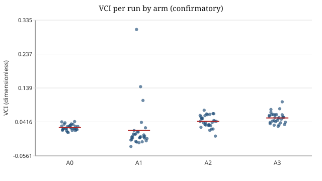
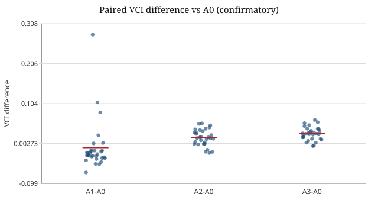
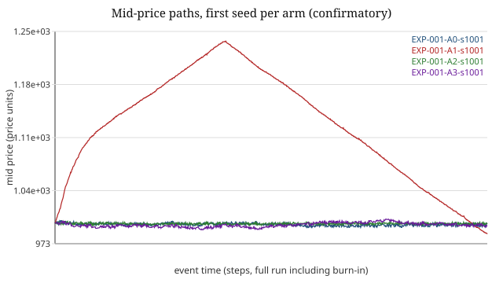
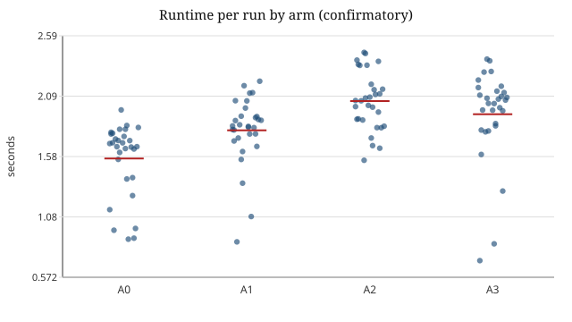

<!-- SPDX-License-Identifier: LicenseRef-MARKET-NC-Research-1.0 -->
# Results summary: EXP-001 (CONFIRMATORY)

Generated by `market.report` from 120 validated run files in `EXP-001/runs/`. Seeds: 1001..1030 (30). Arms: A0, A1, A2, A3. Control for contrasts: A0.

## Arm summary (mean and SD over seeds)

| Arm | Runs | Failed | Degenerate | Runtime mean (s) | VCI | Realised vol. | Mean spread (price units) | Max drawdown | One-sided frac. | Rejected frac. |
| --- | --- | --- | --- | --- | --- | --- | --- | --- | --- | --- |
| A0 | 30 | 0 | 0 | 1.566 | 0.02564 (0.008298) | 0.001302 (3.39e-05) | 1.792 (0.01671) | 0.01051 (0.002913) | 0 (0) | 0 (0) |
| A1 | 30 | 0 | 0 | 1.802 | 0.01781 (0.06483) | 0.0005241 (0.0001892) | 1.3 (0.02458) | 0.2004 (0.05875) | 1.111e-06 (6.086e-06) | 0.003517 (0.001579) |
| A2 | 30 | 0 | 0 | 2.046 | 0.0435 (0.01728) | 0.001391 (3.854e-05) | 2.766 (0.02813) | 0.0057 (0.0008209) | 0 (0) | 0 (0) |
| A3 | 30 | 0 | 0 | 1.937 | 0.05315 (0.01569) | 0.001151 (3.91e-05) | 1.955 (0.02292) | 0.01327 (0.003833) | 0 (0) | 0 (0) |

## Paired contrasts against A0 (mean over seeds of treatment minus control)

Percentile bootstrap 95% interval over seeds (10,000 resamples, seed 20261124); d_z = mean / SD of paired differences.

| Treatment | Metric | Pairs | Mean diff. | SD diff. | d_z | 95% interval |
| --- | --- | --- | --- | --- | --- | --- |
| A1 | vci | 30 | -0.007825 | 0.06479 | -0.121 | [-0.0268, 0.01785] |
| A1 | vci_dt10 | 30 | 0.02481 | 0.03409 | 0.728 | [0.0153, 0.03842] |
| A1 | vci_dt200 | 30 | 0.0915 | 0.1504 | 0.608 | [0.04287, 0.1489] |
| A1 | realised_volatility | 30 | -0.0007775 | 0.0001936 | -4.02 | [-0.0008408, -0.0007058] |
| A1 | mean_spread | 30 | -0.492 | 0.02543 | -19.3 | [-0.5007, -0.4825] |
| A1 | max_drawdown | 30 | 0.1899 | 0.05919 | 3.21 | [0.1704, 0.2122] |
| A2 | vci | 30 | 0.01786 | 0.02099 | 0.851 | [0.01049, 0.02521] |
| A2 | vci_dt10 | 30 | -0.008004 | 0.009209 | -0.869 | [-0.0112, -0.004629] |
| A2 | vci_dt200 | 30 | 0.01928 | 0.02392 | 0.806 | [0.01129, 0.02801] |
| A2 | realised_volatility | 30 | 8.95e-05 | 4.747e-05 | 1.89 | [7.261e-05, 0.0001065] |
| A2 | mean_spread | 30 | 0.974 | 0.02359 | 41.3 | [0.9657, 0.9824] |
| A2 | max_drawdown | 30 | -0.004808 | 0.002591 | -1.86 | [-0.005789, -0.003958] |
| A3 | vci | 30 | 0.02751 | 0.01692 | 1.63 | [0.02169, 0.03358] |
| A3 | vci_dt10 | 30 | 0.0399 | 0.01038 | 3.84 | [0.03632, 0.04361] |
| A3 | vci_dt200 | 30 | 0.01091 | 0.0226 | 0.483 | [0.003255, 0.01899] |
| A3 | realised_volatility | 30 | -0.000151 | 5.646e-05 | -2.67 | [-0.0001705, -0.0001311] |
| A3 | mean_spread | 30 | 0.1627 | 0.02007 | 8.1 | [0.1557, 0.1697] |
| A3 | max_drawdown | 30 | 0.002757 | 0.003765 | 0.732 | [0.001441, 0.004085] |

## Figures

