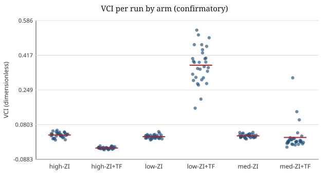
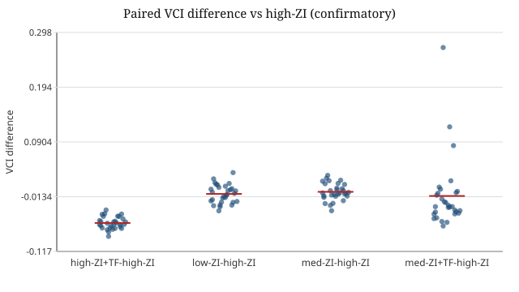
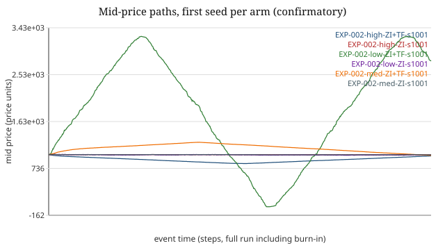
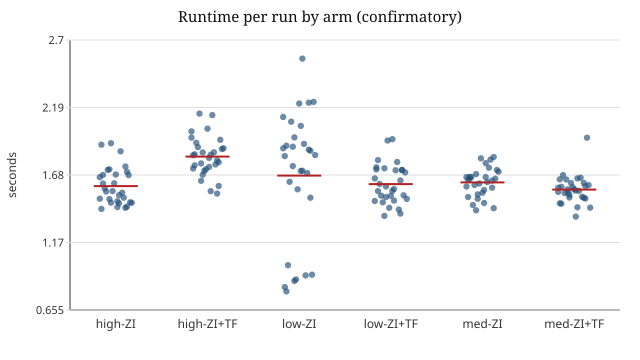

<!-- SPDX-License-Identifier: LicenseRef-MARKET-NC-Research-1.0 -->
# Results summary: EXP-002 (CONFIRMATORY)

Generated by `market.report` from 180 validated run files in `EXP-002/runs/`. Seeds: 1001..1030 (30). Arms: high-ZI, high-ZI+TF, low-ZI, low-ZI+TF, med-ZI, med-ZI+TF. Control for contrasts: high-ZI.

## Arm summary (mean and SD over seeds)

| Arm | Runs | Failed | Degenerate | Runtime mean (s) | VCI | Realised vol. | Mean spread (price units) | Max drawdown | One-sided frac. | Rejected frac. |
| --- | --- | --- | --- | --- | --- | --- | --- | --- | --- | --- |
| high-ZI | 30 | 0 | 0 | 1.594 | 0.0298 (0.01247) | 0.0007165 (1.561e-05) | 1.291 (0.01143) | 0.004952 (0.001149) | 0 (0) | 0 (0) |
| high-ZI+TF | 30 | 0 | 0 | 1.817 | -0.03352 (0.004799) | 0.0003704 (4.307e-05) | 1.132 (0.005144) | 0.1323 (0.01738) | 0 (0) | 0.005519 (0.002079) |
| low-ZI | 30 | 0 | 0 | 1.673 | 0.02165 (0.009086) | 0.002598 (6.674e-05) | 2.923 (0.02446) | 0.02138 (0.005369) | 0 (0) | 0 (0) |
| low-ZI+TF | 30 | 0 | 30 | 1.609 | 0.3689 (0.08861) | 0.05619 (0.01091) | 3.806 (0.04857) | 0.9996 (9.863e-06) | 0.1895 (0.008369) | 0.007707 (0.003007) |
| med-ZI | 30 | 0 | 0 | 1.622 | 0.02564 (0.008298) | 0.001302 (3.39e-05) | 1.792 (0.01671) | 0.01051 (0.002913) | 0 (0) | 0 (0) |
| med-ZI+TF | 30 | 0 | 0 | 1.567 | 0.01781 (0.06483) | 0.0005241 (0.0001892) | 1.3 (0.02458) | 0.2004 (0.05875) | 1.111e-06 (6.086e-06) | 0.003517 (0.001579) |

Arms reported but excluded from every contrast (pre-declared, protocol amendment A1): low-ZI+TF.

## Paired contrasts against high-ZI (mean over seeds of treatment minus control)

Percentile bootstrap 95% interval over seeds (10,000 resamples, seed 20261124); d_z = mean / SD of paired differences.

| Treatment | Metric | Pairs | Mean diff. | SD diff. | d_z | 95% interval |
| --- | --- | --- | --- | --- | --- | --- |
| high-ZI+TF | vci | 30 | -0.06332 | 0.01151 | -5.5 | [-0.06737, -0.05925] |
| high-ZI+TF | vci_dt10 | 30 | 0.0007355 | 0.01115 | 0.066 | [-0.003153, 0.004782] |
| high-ZI+TF | vci_dt200 | 30 | -0.04376 | 0.0167 | -2.62 | [-0.04962, -0.03786] |
| high-ZI+TF | realised_volatility | 30 | -0.000346 | 4.953e-05 | -6.99 | [-0.0003628, -0.0003284] |
| high-ZI+TF | mean_spread | 30 | -0.159 | 0.01143 | -13.9 | [-0.1632, -0.1552] |
| high-ZI+TF | max_drawdown | 30 | 0.1274 | 0.01725 | 7.38 | [0.1207, 0.1327] |
| low-ZI | vci | 30 | -0.008152 | 0.01739 | -0.469 | [-0.01428, -0.002155] |
| low-ZI | vci_dt10 | 30 | -0.01097 | 0.007637 | -1.44 | [-0.01375, -0.008349] |
| low-ZI | vci_dt200 | 30 | -0.008163 | 0.02003 | -0.407 | [-0.0152, -0.001028] |
| low-ZI | realised_volatility | 30 | 0.001882 | 6.756e-05 | 27.8 | [0.001858, 0.001906] |
| low-ZI | mean_spread | 30 | 1.632 | 0.02357 | 69.3 | [1.624, 1.641] |
| low-ZI | max_drawdown | 30 | 0.01643 | 0.005159 | 3.19 | [0.01468, 0.01828] |
| med-ZI | vci | 30 | -0.004164 | 0.01596 | -0.261 | [-0.009915, 0.001342] |
| med-ZI | vci_dt10 | 30 | -0.006913 | 0.008768 | -0.788 | [-0.01001, -0.003944] |
| med-ZI | vci_dt200 | 30 | -0.007537 | 0.01667 | -0.452 | [-0.01335, -0.001733] |
| med-ZI | realised_volatility | 30 | 0.0005851 | 3.14e-05 | 18.6 | [0.0005741, 0.0005962] |
| med-ZI | mean_spread | 30 | 0.5009 | 0.01119 | 44.8 | [0.4969, 0.5048] |
| med-ZI | max_drawdown | 30 | 0.005555 | 0.002723 | 2.04 | [0.004659, 0.00658] |
| med-ZI+TF | vci | 30 | -0.01199 | 0.06636 | -0.181 | [-0.03203, 0.01456] |
| med-ZI+TF | vci_dt10 | 30 | 0.0179 | 0.03216 | 0.557 | [0.00905, 0.03069] |
| med-ZI+TF | vci_dt200 | 30 | 0.08396 | 0.1476 | 0.569 | [0.03608, 0.1401] |
| med-ZI+TF | realised_volatility | 30 | -0.0001924 | 0.0001901 | -1.01 | [-0.0002539, -0.000121] |
| med-ZI+TF | mean_spread | 30 | 0.008969 | 0.02416 | 0.371 | [0.0008255, 0.01801] |
| med-ZI+TF | max_drawdown | 30 | 0.1955 | 0.05864 | 3.33 | [0.1761, 0.2177] |

## Figures

