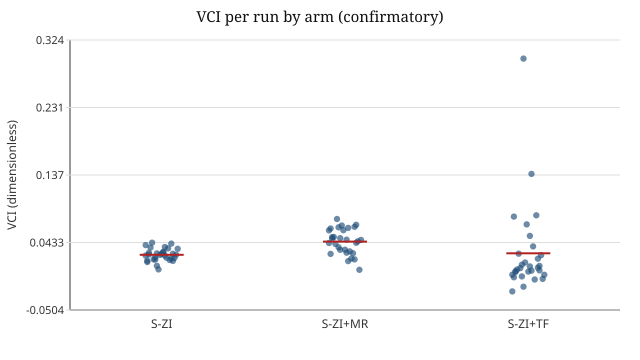
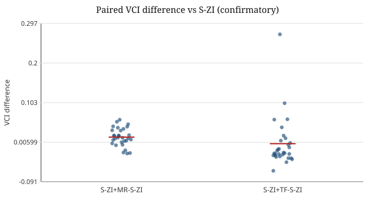
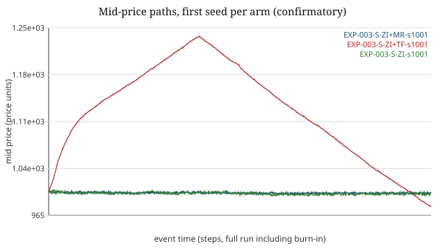
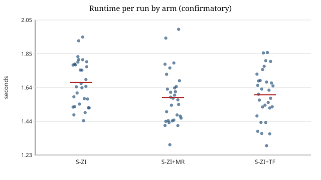

<!-- SPDX-License-Identifier: LicenseRef-MARKET-NC-Research-1.0 -->
# Results summary: EXP-003 (CONFIRMATORY)

Generated by `market.report` from 90 validated run files in `EXP-003/runs/`. Seeds: 1001..1030 (30). Arms: S-ZI, S-ZI+MR, S-ZI+TF. Control for contrasts: S-ZI.

## Arm summary (mean and SD over seeds)

| Arm | Runs | Failed | Degenerate | Runtime mean (s) | VCI | Realised vol. | Mean spread (price units) | Max drawdown | One-sided frac. | Rejected frac. |
| --- | --- | --- | --- | --- | --- | --- | --- | --- | --- | --- |
| S-ZI | 30 | 0 | 0 | 1.674 | 0.02616 (0.008723) | 0.001307 (3.396e-05) | 1.793 (0.017) | 0.012 (0.003819) | 0 (0) | 0 (0) |
| S-ZI+MR | 30 | 0 | 0 | 1.582 | 0.04449 (0.01751) | 0.001402 (3.946e-05) | 2.77 (0.02992) | 0.006981 (0.001104) | 0 (0) | 0 (0) |
| S-ZI+TF | 30 | 0 | 0 | 1.599 | 0.0283 (0.0615) | 0.0005681 (0.000211) | 1.312 (0.02661) | 0.2198 (0.05862) | 1.111e-06 (6.086e-06) | 0.004592 (0.002524) |

## Paired contrasts against S-ZI (mean over seeds of treatment minus control)

Percentile bootstrap 95% interval over seeds (10,000 resamples, seed 20261124); d_z = mean / SD of paired differences.

| Treatment | Metric | Pairs | Mean diff. | SD diff. | d_z | 95% interval |
| --- | --- | --- | --- | --- | --- | --- |
| S-ZI+MR | vci | 30 | 0.01834 | 0.02213 | 0.828 | [0.01063, 0.02623] |
| S-ZI+MR | vci_dt10 | 30 | -0.007456 | 0.009249 | -0.806 | [-0.01066, -0.004122] |
| S-ZI+MR | vci_dt200 | 30 | 0.01815 | 0.02488 | 0.73 | [0.0098, 0.02729] |
| S-ZI+MR | realised_volatility | 30 | 9.498e-05 | 4.77e-05 | 1.99 | [7.799e-05, 0.0001121] |
| S-ZI+MR | mean_spread | 30 | 0.9771 | 0.02467 | 39.6 | [0.9681, 0.9858] |
| S-ZI+MR | max_drawdown | 30 | -0.005021 | 0.003639 | -1.38 | [-0.006395, -0.003802] |
| S-ZI+TF | vci | 30 | 0.002143 | 0.06161 | 0.0348 | [-0.01666, 0.02613] |
| S-ZI+TF | vci_dt10 | 30 | 0.0283 | 0.03203 | 0.884 | [0.01932, 0.04103] |
| S-ZI+TF | vci_dt200 | 30 | 0.1249 | 0.1485 | 0.841 | [0.07521, 0.18] |
| S-ZI+TF | realised_volatility | 30 | -0.0007388 | 0.0002138 | -3.46 | [-0.0008093, -0.0006592] |
| S-ZI+TF | mean_spread | 30 | -0.4811 | 0.02807 | -17.1 | [-0.491, -0.471] |
| S-ZI+TF | max_drawdown | 30 | 0.2078 | 0.05902 | 3.52 | [0.1884, 0.2305] |

## Figures

