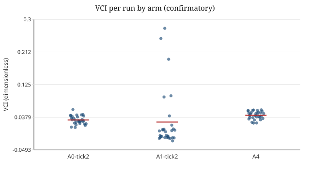
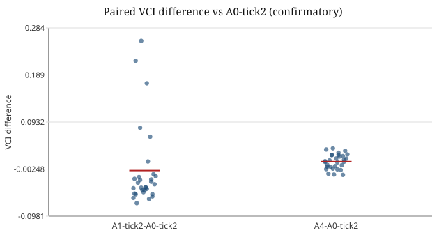
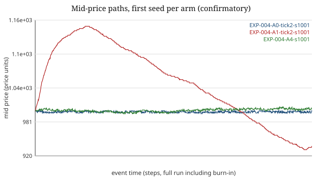
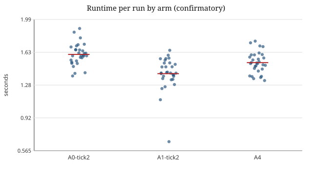

<!-- SPDX-License-Identifier: LicenseRef-MARKET-NC-Research-1.0 -->
# Results summary: EXP-004 (CONFIRMATORY)

Generated by `market.report` from 90 validated run files in `EXP-004/runs/`. Seeds: 1001..1030 (30). Arms: A0-tick2, A1-tick2, A4. Control for contrasts: A0-tick2.

## Arm summary (mean and SD over seeds)

| Arm | Runs | Failed | Degenerate | Runtime mean (s) | VCI | Realised vol. | Mean spread (price units) | Max drawdown | One-sided frac. | Rejected frac. |
| --- | --- | --- | --- | --- | --- | --- | --- | --- | --- | --- |
| A0-tick2 | 30 | 0 | 0 | 1.607 | 0.0304 (0.0112) | 0.001292 (3.38e-05) | 2.465 (0.01561) | 0.007107 (0.001623) | 0 (0) | 0 (0) |
| A1-tick2 | 30 | 0 | 0 | 1.399 | 0.02497 (0.07874) | 0.0006509 (0.0002677) | 2.103 (0.02652) | 0.1413 (0.08982) | 7.037e-06 (3.854e-05) | 0.002206 (0.001899) |
| A4 | 30 | 0 | 0 | 1.518 | 0.04315 (0.01064) | 0.001141 (2.967e-05) | 1.9 (0.0273) | 0.01247 (0.00351) | 0 (0) | 0 (0) |

## Paired contrasts against A0-tick2 (mean over seeds of treatment minus control)

Percentile bootstrap 95% interval over seeds (10,000 resamples, seed 20261124); d_z = mean / SD of paired differences.

| Treatment | Metric | Pairs | Mean diff. | SD diff. | d_z | 95% interval |
| --- | --- | --- | --- | --- | --- | --- |
| A1-tick2 | vci | 30 | -0.005427 | 0.08268 | -0.0656 | [-0.03144, 0.02572] |
| A1-tick2 | vci_dt10 | 30 | 0.05011 | 0.03275 | 1.53 | [0.0402, 0.06267] |
| A1-tick2 | vci_dt200 | 30 | 0.06836 | 0.1684 | 0.406 | [0.01398, 0.1318] |
| A1-tick2 | realised_volatility | 30 | -0.0006411 | 0.0002632 | -2.44 | [-0.000726, -0.0005413] |
| A1-tick2 | mean_spread | 30 | -0.3619 | 0.03056 | -11.8 | [-0.3723, -0.3504] |
| A1-tick2 | max_drawdown | 30 | 0.1342 | 0.0897 | 1.5 | [0.1054, 0.1683] |
| A4 | vci | 30 | 0.01275 | 0.01514 | 0.842 | [0.007557, 0.01806] |
| A4 | vci_dt10 | 30 | 0.03386 | 0.01378 | 2.46 | [0.02892, 0.03859] |
| A4 | vci_dt200 | 30 | -0.002659 | 0.02336 | -0.114 | [-0.01116, 0.005365] |
| A4 | realised_volatility | 30 | -0.0001506 | 3.743e-05 | -4.02 | [-0.0001636, -0.0001374] |
| A4 | mean_spread | 30 | -0.5652 | 0.02229 | -25.4 | [-0.573, -0.5574] |
| A4 | max_drawdown | 30 | 0.005358 | 0.003607 | 1.49 | [0.004101, 0.006631] |

## Figures

