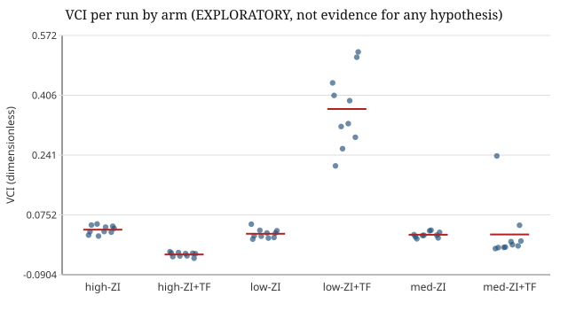
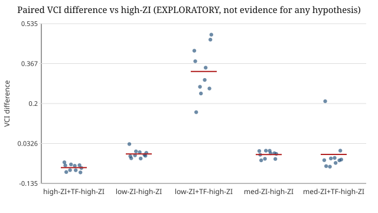
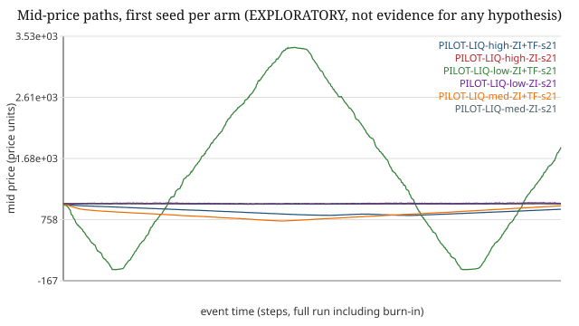
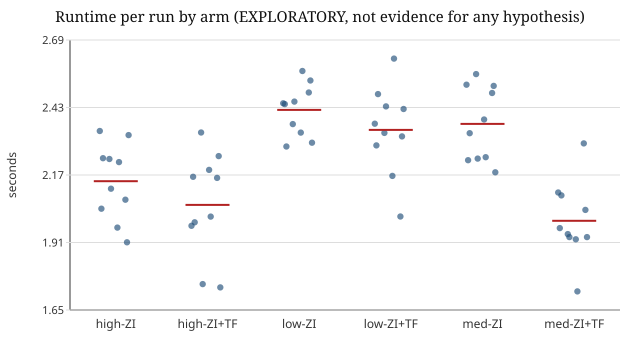

<!-- SPDX-License-Identifier: LicenseRef-MARKET-NC-Research-1.0 -->
# Results summary: PILOT-LIQ (EXPLORATORY)

**Exploratory output on development seeds. Not a finding, not evidence for or against any hypothesis, and never to be quoted as a result.** It exists to measure runtime, seed spread and degenerate cases before the owner freezes the protocol.

Generated by `market.report` from 60 validated run files in `PILOT-LIQ/runs/`. Seeds: 21..30 (10). Arms: high-ZI, high-ZI+TF, low-ZI, low-ZI+TF, med-ZI, med-ZI+TF. Control for contrasts: high-ZI.

## Arm summary (mean and SD over seeds)

| Arm | Runs | Failed | Degenerate | Runtime mean (s) | VCI | Realised vol. | Mean spread (price units) | Max drawdown | One-sided frac. | Rejected frac. |
| --- | --- | --- | --- | --- | --- | --- | --- | --- | --- | --- |
| high-ZI | 10 | 0 | 0 | 2.149 | 0.03413 (0.01156) | 0.000726 (1.891e-05) | 1.291 (0.01518) | 0.005095 (0.001105) | 0 (0) | 0 (0) |
| high-ZI+TF | 10 | 0 | 0 | 2.058 | -0.03435 (0.005707) | 0.0003693 (4.047e-05) | 1.127 (0.01158) | 0.1352 (0.03798) | 0 (0) | 0.004888 (0.003611) |
| low-ZI | 10 | 0 | 0 | 2.425 | 0.02289 (0.01254) | 0.002603 (3.999e-05) | 2.932 (0.03469) | 0.01935 (0.004279) | 0 (0) | 0 (0) |
| low-ZI+TF | 10 | 0 | 10 | 2.348 | 0.3684 (0.1052) | 0.05637 (0.01085) | 3.796 (0.04918) | 0.9996 (1.849e-05) | 0.1881 (0.008513) | 0.008228 (0.004415) |
| med-ZI | 10 | 0 | 0 | 2.371 | 0.02021 (0.007925) | 0.001293 (2.494e-05) | 1.79 (0.01997) | 0.00917 (0.001992) | 0 (0) | 0 (0) |
| med-ZI+TF | 10 | 0 | 0 | 1.996 | 0.02089 (0.07875) | 0.000425 (6.717e-05) | 1.297 (0.03097) | 0.176 (0.04665) | 0 (0) | 0.003798 (0.001623) |

## Paired contrasts against high-ZI (mean over seeds of treatment minus control)

Percentile bootstrap 95% interval over seeds (10,000 resamples, seed 20261124); d_z = mean / SD of paired differences.

| Treatment | Metric | Pairs | Mean diff. | SD diff. | d_z | 95% interval |
| --- | --- | --- | --- | --- | --- | --- |
| high-ZI+TF | vci | 10 | -0.06849 | 0.01454 | -4.71 | [-0.07716, -0.06005] |
| high-ZI+TF | vci_dt10 | 10 | -0.004464 | 0.01036 | -0.431 | [-0.0104, 0.001747] |
| high-ZI+TF | vci_dt200 | 10 | -0.04088 | 0.02135 | -1.91 | [-0.0533, -0.02853] |
| high-ZI+TF | realised_volatility | 10 | -0.0003567 | 5.472e-05 | -6.52 | [-0.0003884, -0.0003237] |
| high-ZI+TF | mean_spread | 10 | -0.1647 | 0.01532 | -10.8 | [-0.174, -0.156] |
| high-ZI+TF | max_drawdown | 10 | 0.1301 | 0.03798 | 3.42 | [0.1061, 0.1521] |
| low-ZI | vci | 10 | -0.01125 | 0.01764 | -0.638 | [-0.02042, -1.587e-05] |
| low-ZI | vci_dt10 | 10 | -0.01617 | 0.01417 | -1.14 | [-0.02457, -0.007845] |
| low-ZI | vci_dt200 | 10 | -0.005568 | 0.02026 | -0.275 | [-0.01775, 0.00584] |
| low-ZI | realised_volatility | 10 | 0.001877 | 4.757e-05 | 39.5 | [0.001849, 0.001905] |
| low-ZI | mean_spread | 10 | 1.641 | 0.02423 | 67.7 | [1.628, 1.656] |
| low-ZI | max_drawdown | 10 | 0.01425 | 0.004554 | 3.13 | [0.01154, 0.01682] |
| low-ZI+TF | vci | 10 | 0.3343 | 0.1051 | 3.18 | [0.2738, 0.3961] |
| low-ZI+TF | vci_dt10 | 10 | 0.3085 | 0.06057 | 5.09 | [0.2718, 0.3423] |
| low-ZI+TF | vci_dt200 | 10 | 0.3905 | 0.08841 | 4.42 | [0.3377, 0.441] |
| low-ZI+TF | realised_volatility | 10 | 0.05565 | 0.01086 | 5.12 | [0.04943, 0.06214] |
| low-ZI+TF | mean_spread | 10 | 2.505 | 0.04285 | 58.5 | [2.479, 2.529] |
| low-ZI+TF | max_drawdown | 10 | 0.9945 | 0.00111 | 896 | [0.9938, 0.9951] |
| med-ZI | vci | 10 | -0.01393 | 0.01509 | -0.923 | [-0.02294, -0.005564] |
| med-ZI | vci_dt10 | 10 | -0.007889 | 0.007539 | -1.05 | [-0.01238, -0.003488] |
| med-ZI | vci_dt200 | 10 | -0.00866 | 0.02357 | -0.367 | [-0.02279, 0.004931] |
| med-ZI | realised_volatility | 10 | 0.0005667 | 2.44e-05 | 23.2 | [0.0005522, 0.0005807] |
| med-ZI | mean_spread | 10 | 0.4985 | 0.007528 | 66.2 | [0.4941, 0.503] |
| med-ZI | max_drawdown | 10 | 0.004075 | 0.001725 | 2.36 | [0.002982, 0.005065] |
| med-ZI+TF | vci | 10 | -0.01325 | 0.08056 | -0.164 | [-0.04661, 0.03918] |
| med-ZI+TF | vci_dt10 | 10 | 0.0123 | 0.02563 | 0.48 | [0.00045, 0.02884] |
| med-ZI+TF | vci_dt200 | 10 | 0.09615 | 0.2209 | 0.435 | [-0.004938, 0.2381] |
| med-ZI+TF | realised_volatility | 10 | -0.0003009 | 8.041e-05 | -3.74 | [-0.0003438, -0.0002493] |
| med-ZI+TF | mean_spread | 10 | 0.005543 | 0.02247 | 0.247 | [-0.00739, 0.01883] |
| med-ZI+TF | max_drawdown | 10 | 0.1709 | 0.04652 | 3.67 | [0.1414, 0.1952] |

## Figures

