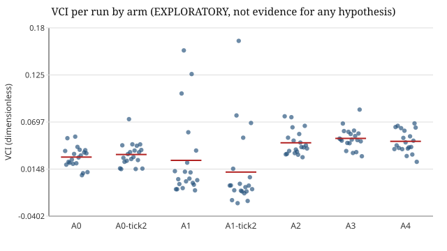
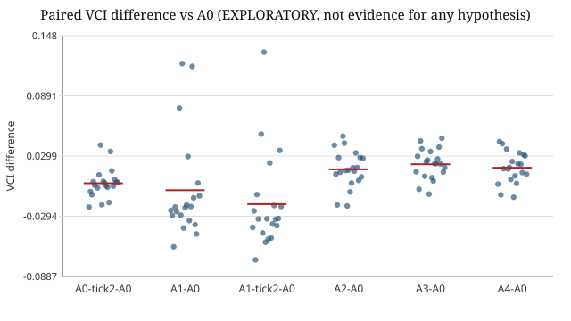
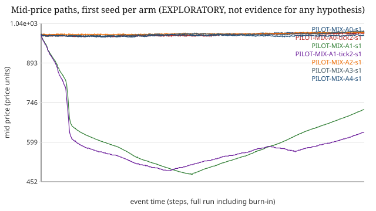
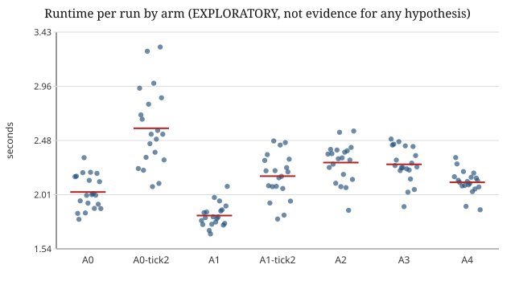

<!-- SPDX-License-Identifier: LicenseRef-MARKET-NC-Research-1.0 -->
# Results summary: PILOT-MIX (EXPLORATORY)

**Exploratory output on development seeds. Not a finding, not evidence for or against any hypothesis, and never to be quoted as a result.** It exists to measure runtime, seed spread and degenerate cases before the owner freezes the protocol.

Generated by `market.report` from 140 validated run files in `PILOT-MIX/runs/`. Seeds: 1..20 (20). Arms: A0, A0-tick2, A1, A1-tick2, A2, A3, A4. Control for contrasts: A0.

## Arm summary (mean and SD over seeds)

| Arm | Runs | Failed | Degenerate | Runtime mean (s) | VCI | Realised vol. | Mean spread (price units) | Max drawdown | One-sided frac. | Rejected frac. |
| --- | --- | --- | --- | --- | --- | --- | --- | --- | --- | --- |
| A0 | 20 | 0 | 0 | 2.035 | 0.02877 (0.01222) | 0.001309 (1.926e-05) | 1.795 (0.01639) | 0.01027 (0.003227) | 0 (0) | 0 (0) |
| A0-tick2 | 20 | 0 | 0 | 2.591 | 0.03182 (0.01376) | 0.001319 (2.982e-05) | 2.47 (0.01316) | 0.007335 (0.002146) | 0 (0) | 0 (0) |
| A1 | 20 | 0 | 0 | 1.831 | 0.02499 (0.04778) | 0.0005459 (0.0001616) | 1.31 (0.02102) | 0.1998 (0.06126) | 0 (0) | 0.003722 (0.001699) |
| A1-tick2 | 20 | 0 | 0 | 2.174 | 0.01131 (0.04618) | 0.0007619 (0.0006834) | 2.103 (0.02624) | 0.1731 (0.1448) | 1.611e-05 (7.205e-05) | 0.001877 (0.001979) |
| A2 | 20 | 0 | 0 | 2.292 | 0.04551 (0.01461) | 0.00138 (3.867e-05) | 2.769 (0.03429) | 0.005683 (0.001157) | 0 (0) | 0 (0) |
| A3 | 20 | 0 | 0 | 2.277 | 0.05059 (0.01256) | 0.001149 (3.917e-05) | 1.956 (0.02768) | 0.01232 (0.00437) | 0 (0) | 0 (0) |
| A4 | 20 | 0 | 0 | 2.120 | 0.04717 (0.0131) | 0.001143 (3.004e-05) | 1.903 (0.02059) | 0.01159 (0.003253) | 0 (0) | 0 (0) |

## Paired contrasts against A0 (mean over seeds of treatment minus control)

Percentile bootstrap 95% interval over seeds (10,000 resamples, seed 20261124); d_z = mean / SD of paired differences.

| Treatment | Metric | Pairs | Mean diff. | SD diff. | d_z | 95% interval |
| --- | --- | --- | --- | --- | --- | --- |
| A0-tick2 | vci | 20 | 0.003047 | 0.01493 | 0.204 | [-0.002843, 0.009853] |
| A0-tick2 | vci_dt10 | 20 | 0.007598 | 0.005678 | 1.34 | [0.005171, 0.01007] |
| A0-tick2 | vci_dt200 | 20 | -0.001236 | 0.02372 | -0.0521 | [-0.01145, 0.00897] |
| A0-tick2 | realised_volatility | 20 | 1.043e-05 | 2.603e-05 | 0.401 | [-4.791e-07, 2.158e-05] |
| A0-tick2 | mean_spread | 20 | 0.6753 | 0.009034 | 74.8 | [0.6715, 0.6792] |
| A0-tick2 | max_drawdown | 20 | -0.002934 | 0.002181 | -1.34 | [-0.003893, -0.00204] |
| A1 | vci | 20 | -0.003781 | 0.05114 | -0.0739 | [-0.02328, 0.02025] |
| A1 | vci_dt10 | 20 | 0.01781 | 0.01516 | 1.18 | [0.01176, 0.02476] |
| A1 | vci_dt200 | 20 | 0.1319 | 0.1534 | 0.86 | [0.07101, 0.202] |
| A1 | realised_volatility | 20 | -0.0007627 | 0.0001681 | -4.54 | [-0.0008301, -0.0006886] |
| A1 | mean_spread | 20 | -0.4842 | 0.02492 | -19.4 | [-0.4945, -0.4736] |
| A1 | max_drawdown | 20 | 0.1895 | 0.06072 | 3.12 | [0.1621, 0.215] |
| A1-tick2 | vci | 20 | -0.01746 | 0.0467 | -0.374 | [-0.03501, 0.004459] |
| A1-tick2 | vci_dt10 | 20 | 0.0501 | 0.01337 | 3.75 | [0.04441, 0.05578] |
| A1-tick2 | vci_dt200 | 20 | 0.0527 | 0.139 | 0.379 | [-0.0001635, 0.1165] |
| A1-tick2 | realised_volatility | 20 | -0.0005468 | 0.0006785 | -0.806 | [-0.0007506, -0.0002155] |
| A1-tick2 | mean_spread | 20 | 0.3084 | 0.0328 | 9.4 | [0.2951, 0.3227] |
| A1-tick2 | max_drawdown | 20 | 0.1629 | 0.1433 | 1.14 | [0.1177, 0.2332] |
| A2 | vci | 20 | 0.01673 | 0.0183 | 0.915 | [0.00879, 0.02446] |
| A2 | vci_dt10 | 20 | -0.01024 | 0.008044 | -1.27 | [-0.01359, -0.006792] |
| A2 | vci_dt200 | 20 | 0.01444 | 0.03159 | 0.457 | [0.0009791, 0.0282] |
| A2 | realised_volatility | 20 | 7.172e-05 | 4.224e-05 | 1.7 | [5.414e-05, 9e-05] |
| A2 | mean_spread | 20 | 0.9745 | 0.03092 | 31.5 | [0.9614, 0.9874] |
| A2 | max_drawdown | 20 | -0.004586 | 0.002785 | -1.65 | [-0.005781, -0.003411] |
| A3 | vci | 20 | 0.02181 | 0.01479 | 1.48 | [0.01548, 0.02802] |
| A3 | vci_dt10 | 20 | 0.03768 | 0.007106 | 5.3 | [0.03465, 0.04072] |
| A3 | vci_dt200 | 20 | 0.004088 | 0.03134 | 0.13 | [-0.009687, 0.01719] |
| A3 | realised_volatility | 20 | -0.0001599 | 3.895e-05 | -4.11 | [-0.0001764, -0.0001434] |
| A3 | mean_spread | 20 | 0.1611 | 0.02601 | 6.19 | [0.15, 0.1719] |
| A3 | max_drawdown | 20 | 0.002052 | 0.004161 | 0.493 | [0.0003366, 0.00395] |
| A4 | vci | 20 | 0.01839 | 0.0153 | 1.2 | [0.01197, 0.02478] |
| A4 | vci_dt10 | 20 | 0.0446 | 0.01009 | 4.42 | [0.04044, 0.04906] |
| A4 | vci_dt200 | 20 | -0.004348 | 0.0264 | -0.165 | [-0.01566, 0.006847] |
| A4 | realised_volatility | 20 | -0.0001655 | 3.052e-05 | -5.42 | [-0.0001786, -0.0001524] |
| A4 | mean_spread | 20 | 0.1086 | 0.01735 | 6.26 | [0.1012, 0.116] |
| A4 | max_drawdown | 20 | 0.001321 | 0.00299 | 0.442 | [-1.628e-05, 0.002514] |

## Figures

