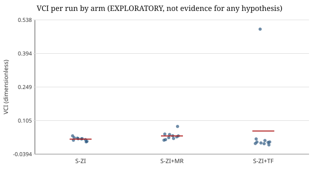
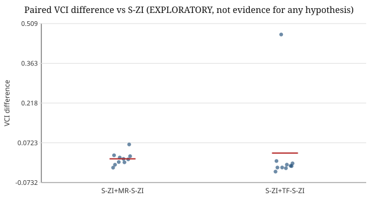
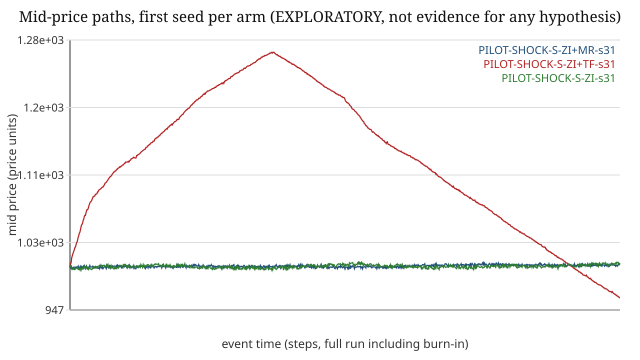
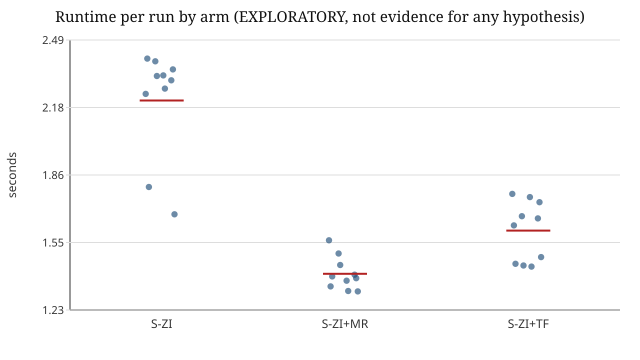

<!-- SPDX-License-Identifier: LicenseRef-MARKET-NC-Research-1.0 -->
# Results summary: PILOT-SHOCK (EXPLORATORY)

**Exploratory output on development seeds. Not a finding, not evidence for or against any hypothesis, and never to be quoted as a result.** It exists to measure runtime, seed spread and degenerate cases before the owner freezes the protocol.

Generated by `market.report` from 30 validated run files in `PILOT-SHOCK/runs/`. Seeds: 31..40 (10). Arms: S-ZI, S-ZI+MR, S-ZI+TF. Control for contrasts: S-ZI.

## Arm summary (mean and SD over seeds)

| Arm | Runs | Failed | Degenerate | Runtime mean (s) | VCI | Realised vol. | Mean spread (price units) | Max drawdown | One-sided frac. | Rejected frac. |
| --- | --- | --- | --- | --- | --- | --- | --- | --- | --- | --- |
| S-ZI | 10 | 0 | 0 | 2.211 | 0.02524 (0.007527) | 0.001316 (2.659e-05) | 1.795 (0.01513) | 0.01184 (0.003325) | 0 (0) | 0 (0) |
| S-ZI+MR | 10 | 0 | 0 | 1.401 | 0.03884 (0.01681) | 0.00141 (4.579e-05) | 2.78 (0.02574) | 0.007879 (0.001166) | 0 (0) | 0 (0) |
| S-ZI+TF | 10 | 0 | 0 | 1.603 | 0.06012 (0.1542) | 0.0006844 (0.0003318) | 1.332 (0.04501) | 0.235 (0.0725) | 0.0001089 (0.0003443) | 0.004074 (0.002495) |

## Paired contrasts against S-ZI (mean over seeds of treatment minus control)

Percentile bootstrap 95% interval over seeds (10,000 resamples, seed 20261124); d_z = mean / SD of paired differences.

| Treatment | Metric | Pairs | Mean diff. | SD diff. | d_z | 95% interval |
| --- | --- | --- | --- | --- | --- | --- |
| S-ZI+MR | vci | 10 | 0.0136 | 0.02322 | 0.586 | [0.0009926, 0.02836] |
| S-ZI+MR | vci_dt10 | 10 | -0.009835 | 0.01006 | -0.978 | [-0.01559, -0.0039] |
| S-ZI+MR | vci_dt200 | 10 | 0.009214 | 0.03583 | 0.257 | [-0.01026, 0.03178] |
| S-ZI+MR | realised_volatility | 10 | 9.444e-05 | 5.907e-05 | 1.6 | [6.222e-05, 0.0001306] |
| S-ZI+MR | mean_spread | 10 | 0.9844 | 0.0214 | 46 | [0.9717, 0.9967] |
| S-ZI+MR | max_drawdown | 10 | -0.003965 | 0.003042 | -1.3 | [-0.005715, -0.002132] |
| S-ZI+TF | vci | 10 | 0.03488 | 0.1528 | 0.228 | [-0.01812, 0.1332] |
| S-ZI+TF | vci_dt10 | 10 | 0.04621 | 0.07644 | 0.605 | [0.0166, 0.09626] |
| S-ZI+TF | vci_dt200 | 10 | 0.1254 | 0.1369 | 0.916 | [0.05454, 0.2128] |
| S-ZI+TF | realised_volatility | 10 | -0.0006312 | 0.0003369 | -1.87 | [-0.0008003, -0.0004084] |
| S-ZI+TF | mean_spread | 10 | -0.4635 | 0.04766 | -9.73 | [-0.4878, -0.4326] |
| S-ZI+TF | max_drawdown | 10 | 0.2231 | 0.07319 | 3.05 | [0.1883, 0.2719] |

## Figures

