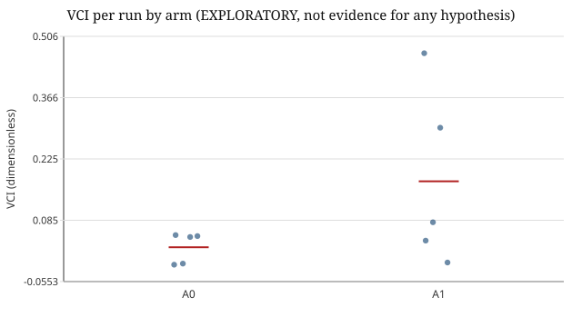
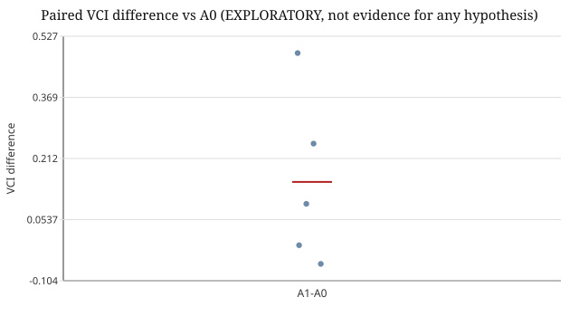
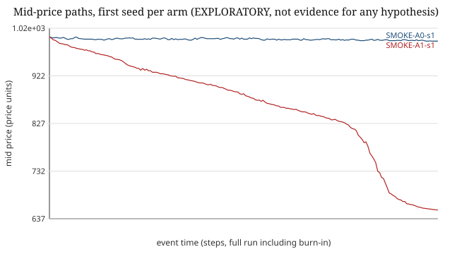
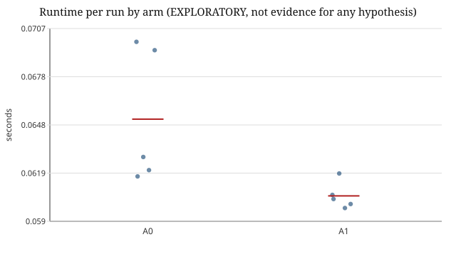

<!-- SPDX-License-Identifier: LicenseRef-MARKET-NC-Research-1.0 -->
# Results summary: SMOKE (EXPLORATORY)

**Exploratory output on development seeds. Not a finding, not evidence for or against any hypothesis, and never to be quoted as a result.** It exists to measure runtime, seed spread and degenerate cases before the owner freezes the protocol.

Generated by `market.report` from 10 validated run files in `smoke-M3/runs/`. Seeds: 1..5 (5). Arms: A0, A1. Control for contrasts: A0.

## Arm summary (mean and SD over seeds)

| Arm | Runs | Failed | Degenerate | Runtime mean (s) | VCI | Realised vol. | Mean spread (price units) | Max drawdown | One-sided frac. | Rejected frac. |
| --- | --- | --- | --- | --- | --- | --- | --- | --- | --- | --- |
| A0 | 5 | 0 | 0 | 0.065 | 0.02321 (0.03525) | 0.001298 (0.0001052) | 1.784 (0.05575) | 0.005988 (0.0007171) | 0 (0) | 0 (0) |
| A1 | 5 | 0 | 0 | 0.061 | 0.1742 (0.2017) | 0.001506 (0.0012) | 1.697 (0.1867) | 0.1446 (0.1276) | 0.001667 (0.002299) | 0 (0) |

## Paired contrasts against A0 (mean over seeds of treatment minus control)

Percentile bootstrap 95% interval over seeds (10,000 resamples, seed 20261124); d_z = mean / SD of paired differences.

| Treatment | Metric | Pairs | Mean diff. | SD diff. | d_z | 95% interval |
| --- | --- | --- | --- | --- | --- | --- |
| A1 | vci | 5 | 0.151 | 0.221 | 0.684 | [-0.01036, 0.3378] |
| A1 | vci_dt10 | 5 | 0.1064 | 0.1204 | 0.884 | [0.01698, 0.1973] |
| A1 | vci_dt200 | 5 | 0.2249 | 0.04664 | 4.82 | [0.1872, 0.2593] |
| A1 | realised_volatility | 5 | 0.0002073 | 0.001282 | 0.162 | [-0.0006706, 0.001345] |
| A1 | mean_spread | 5 | -0.08695 | 0.1637 | -0.531 | [-0.2065, 0.05252] |
| A1 | max_drawdown | 5 | 0.1386 | 0.127 | 1.09 | [0.0451, 0.246] |

## Figures

